# ECON Enterprise Digital Twin: System Architecture & Onboarding Reference

**Author:** ECON Core Engineering Team & Technical Documentation Lead  
**Document Version:** 2.4.0  
**Target Release:** Enterprise Production & Research Baseline  
**Project Workspace:** `/Users/nguyenhoangkhoi/Documents/econ`  
**Associated Publications:** ECON Scientific Paper (`PAPER.md`)  

---

## 1. Executive Summary & Full-System Architecture Mind Map

### 1.1 Executive Summary
The **ECON Enterprise Digital Twin** is an end-to-end, physics-grounded cyber-physical building energy and indoor environmental management platform. Designed to overcome the operational and architectural limitations of legacy Building Management Systems (BMS), ECON couples real-time physical telemetry with continuous first-principles thermodynamic simulation, online system identification, and generative AI forecasting.

The platform is architected around the core engineering principle: **"Never fabricate a measurement"**. Physical edge microcontrollers report strictly what has been observed; absent or failing sensors cause telemetry fields to be omitted rather than replaced with synthetic constants. In the absence of physical sensors, the Go backend engine executes an autonomous lumped-capacitance 2R1C thermodynamic model, a closed-form Hardy Cross airflow solver, and diurnal occupancy profiles running at 30 FPS.

The complete system spans seven ascending architectural layers—from physical edge silicon to browser-rendered WebGL:
1. **Layer 1: Edge Hardware & Sensors**: ESP32 DevKit and Raspberry Pi Pico microcontrollers hosting 16+ sensor and actuator modalities across I2C, ADC, 1-Wire, UART, and digital interfaces.
2. **Layer 2: Communication & Message Broker**: Eclipse Mosquitto MQTT broker with role-based ACLs, DualModeComm (UDP/MQTT/Serial), strict topic hierarchies, and an autonomous edge gateway failsafe daemon.
3. **Layer 3: Backend Engine & Simulation**: High-throughput Go simulation engine integrating 30 FPS 2R1C thermal ODEs, closed-form Hardy Cross fluid networks, Recursive Least Squares (RLS) room identification, Autonomous Plug-Load Control (APLC), dynamic vacancy setback optimization, pre-cooling loops, and sensorless "Shadow Twin" Automated Fault Detection & Diagnostics (AFDD).
4. **Layer 4: AI/ML & Forecasting**: Supervised PeakLoadLSTM, Google TimesFM zero-shot foundation models (231M/500M parameters), online Welford learned baselines, and cross-process HTTP IPC with plausibility gating.
5. **Layer 5: Database & Persistence**: PostgreSQL with TimescaleDB hypertables, 5-minute continuous aggregates, an 8192-capacity lockless write buffer, and 60-second durable JSON state checkpointing.
6. **Layer 6: API Layer**: 32 REST endpoints and high-speed binary Google FlatBuffers WebSocket streaming at 30 Hz with CSWSH protection and constant-time token verification.
7. **Layer 7: Frontend Dashboard**: React 18, Vite 5, Three.js / React Three Fiber procedural BIM 3D digital twin with CSG window cutouts, custom GLSL thermal heatmap shaders, and honest Recharts forecast deciles.

---

### 1.2 Full-System Architecture Mind Map


---

## 2. Zero-Hardware Simulation Path & Developer Quick-Start Guide

The ECON platform provides a fully autonomous, zero-hardware simulation path. Collaborators and new team members can build, execute, debug, and test the entire system without connecting a single microcontroller, wire, or sensor.

### 2.1 Simulation Architecture & Principles
When physical edge hardware is absent:
1. **Autonomous 2R1C Thermal Integration**: The Go engine evaluates `z.hwFresh()` (`server/simulation/engine.go:999–1002`). When no MQTT packet has arrived for $>20$ seconds (`hwStaleAfter`), physical sensor pinning disengages. The zone’s air ($T_{\text{air}}$) and wall ($T_{\text{wall}}$) temperatures are governed strictly by the Forward Euler integration of the 2R1C thermodynamic ODEs.
2. **Climatological Diurnal Weather Model**: If external weather APIs are unreachable, outdoor temperature follows a deterministic Ho Chi Minh City diurnal sinusoid (`engine.go:1007–1021`):
   $$T_{\text{out}}(t) = 29.5 + 4.5 \cos\left(\frac{2\pi (t_{\text{hour}} - 15)}{24}\right) \quad [25.0^\circ\text{C}\text{ at dawn to }34.0^\circ\text{C}\text{ at 15:00}]$$
3. **Diurnal Building Occupancy Schedule**: Occupancy schedules modulate human density and internal thermal gains based on standard commercial building operating hours (`engine.go:2022`).
4. **Closed-Form Hardy Cross Airflow**: Duct static pressures and VAV branch airflows are computed from damper positions and fan curves without requiring physical flow sensors.

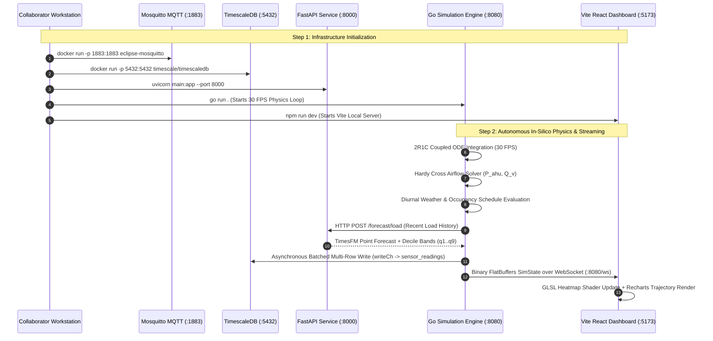

---

### 2.2 Step-by-Step Local Quick-Start Guide

Follow these commands to launch the complete ECON stack locally on macOS or Linux:

#### Terminal 1: Infrastructure Services (MQTT Broker & TimescaleDB)
```bash
cd /Users/nguyenhoangkhoi/Documents/econ/server

# Launch Mosquitto broker and TimescaleDB via Docker Compose
docker compose up -d mqtt db

# Verify services are healthy
docker compose ps
# Mosquitto listening on localhost:1883
# TimescaleDB listening on localhost:5432 (user: postgres, pass: postgres, db: econ)
```
*(Note: If Docker is unavailable, Mosquitto and PostgreSQL/TimescaleDB can be installed and executed natively via Homebrew or apt).*

#### Terminal 2: AI Forecasting Microservice (Python FastAPI)
```bash
cd /Users/nguyenhoangkhoi/Documents/econ/backend/forecasting

# Create and activate virtual environment
python3 -m venv venv
source venv/bin/activate

# Install dependencies (PyTorch, Transformers, FastAPI, Uvicorn)
pip install -r requirements.txt

# Execute supervised trainer to generate local model weights and scaler
python train.py

# Launch FastAPI forecasting server
uvicorn main:app --host 0.0.0.0 --port 8000 --reload
# Service ready at http://localhost:8000
# OpenAPI documentation available at http://localhost:8000/docs
```

#### Terminal 3: Go Backend Simulation Engine
```bash
cd /Users/nguyenhoangkhoi/Documents/econ/server

# Run the Go engine (auto-connects to MQTT :1883, DB :5432, ML :8000)
go run .

# Backend initializes:
# - Loads programme-library.json and building topology
# - Seeds 2R1C thermal states and sizes Hardy Cross fan
# - Starts 30 FPS physics ticker (dt = 33.3ms)
# - Starts FlatBuffers WebSocket server on :8080/ws
# - Starts REST API server on http://localhost:8080
```

#### Terminal 4: Frontend Operations Dashboard (React / Vite)
```bash
cd /Users/nguyenhoangkhoi/Documents/econ/dashboard

# Install npm dependencies
npm install --legacy-peer-deps

# Launch Vite development server
npm run dev
# Dashboard opens at http://localhost:5173
```

---

### 2.3 Synthetic Telemetry Generators & Emulators

To simulate active hardware nodes, test edge binding, inject physical faults, or evaluate computer vision occupancy:

1. **Software ESP32 Emulator (`edge/esp32/esp32_emulator.py`)**:
   Simulates a live ESP32 edge node over MQTT. Connects to `localhost:1883`, publishes realistic telemetry to `econ/telemetry/zone_1`, and responds to actuation commands (`LIGHTS_ON`, `LIGHTS_OFF`, `SETPOINT=22.0`):
   ```bash
   python3 edge/esp32/esp32_emulator.py
   ```

2. **Computer Vision Headcount Tracker (`ai_modules/branch_a_occupancy/yolo_bytetrack/yolo_tracker.py`)**:
   Executes YOLOv8 and ByteTrack on bundled camera footage (`people-detection.mp4`), streaming detected person counts and bounding box confidence to `econ/telemetry/<zone>`:
   ```bash
   cd ai_modules/branch_a_occupancy/yolo_bytetrack
   pip install ultralytics opencv-python paho-mqtt
   python3 yolo_tracker.py
   ```

3. **Wokwi Web Microcontroller Simulation (`edge/esp32/wokwi.toml`, `edge/esp32/diagram.json`)**:
   Runs the compiled ESP32 firmware binary (`firmware.bin`) inside a virtual browser-based ESP32 with simulated DHT22, DS18B20, and relay hardware. Open `diagram.json` in VS Code with the Wokwi extension or on `wokwi.com`.

4. **CLI Telemetry Injection (Testing AFDD Shadow Twin Faults)**:
   Inject an anomalous sensor reading via `mosquitto_pub` to observe real-time AFDD shadow twin residual divergence and alarm triggering:
   ```bash
   mosquitto_pub -h localhost -p 1883 -t econ/telemetry/zone_1 \
     -m '{"zone":"Level 4","occupancy":2,"temperature":33.4,"source":"esp32","tempReal":true}'
   ```

---

## 3. Layer 1: Edge Hardware & Sensors

### 3.1 Edge Hardware Architecture Overview

Layer 1 encompasses the physical sensing and actuation hardware deployed within building thermal zones. The architecture uses a dual-microcontroller topology:
- **Primary Zone Node (ESP32)**: A dual-core Xtensa LX6 running at 240 MHz. Handles high-speed ADC sampling (True-RMS computation), I2C sensor communications, Wi-Fi DualModeComm networking, and local actuation.
- **Auxiliary Coprocessor / Lab Desk Node (Raspberry Pi Pico)**: Powered by the RP2040 dual ARM Cortex-M0+ running at 133 MHz. Acts as a desktop environmental sensor, USB CDC serial bridge, directional PIR headcount monitor, and hardware watchdog supervisor.

```mermaid
graph TD
    subgraph "ESP32 DevKit Node (240MHz Dual Core)"
        ESP[ESP32 Microcontroller]
        I2C_BUS[I2C Hardware Bus<br/>SDA: GPIO 21 / SCL: GPIO 22]
        ADC1_BUS[ADC1 12-Bit Analog Bus<br/>Input-Only Low Noise]
        ONEWIRE_BUS[1-Wire Bus<br/>GPIO 26]
        ACT_BUS[Digital Actuation Bus<br/>GPIO 19, 23, 25]
        DVP_BUS[8-Bit Parallel DVP Bus<br/>Camera Interface]
        TOUCH_PAD[Capacitive Touch Pad<br/>GPIO 32 / T9]
    end

    subgraph "I2C Environmental Sensors"
        SHT30["Sensirion SHT30<br/>Address: 0x44<br/>Ambient Temp & RH (±0.2°C)"]
        ACD1200["ASAIR ACD1200 NDIR<br/>Address: 0x2A (5V VCC)<br/>Indoor CO2 (400-5000 ppm)"]
        BH1750["ROHM BH1750<br/>Address: 0x23<br/>Ambient Illuminance (Lux)"]
        SHIFTER["BSS138 Bidirectional<br/>4-Channel Level Shifter<br/>5V High to 3.3V Low"]
    end

    subgraph "Analog Electrical Metering (ADC1)"
        SCT_PLUG["SCT-013-000 CT (100A:50mA)<br/>GPIO 34 (ADC1_CH6)<br/>33Ω Burden + 1.65V Bias<br/>APLC Socket Bank Metering"]
        ACS712["ACS712-30A Hall Meter<br/>GPIO 33 (ADC1_CH5)<br/>10kΩ/10kΩ Voltage Divider<br/>Power Strip Appliance Metering"]
        SCT_AC["2nd SCT-013-000 CT<br/>GPIO 35 (ADC1_CH7)<br/>33Ω Burden + 1.65V Bias<br/>AC Compressor Metering"]
    end

    subgraph "1-Wire, Presence & Vision"
        DS18B20["DS18B20 Probe<br/>GPIO 26 (4.7kΩ Pull-up)<br/>HVAC Supply Air Discharge Temp"]
        PIR_RADAR["Dual PIR / mmWave Radar<br/>GPIO 18<br/>HC-SR501 / Ai-Thinker Rd-03"]
        OV7670["OV7670 Camera Module<br/>DVP Bus + SCCB<br/>TFLite Micro Person Detection"]
    end

    subgraph "Actuation Hardware"
        RELAY_LIGHT["G3MB-202P Solid State Relay<br/>GPIO 23<br/>220V AC Lighting Circuit"]
        RELAY_PLUG["G3MB-202P Solid State Relay<br/>GPIO 25 (Fail-Energized HIGH)<br/>220V AC Socket Circuit (APLC)"]
        IR_BLASTER["940nm IR Emitter + 2N2222<br/>GPIO 19<br/>38 kHz Split-AC Command Blaster"]
    end

    subgraph "RP2040 Raspberry Pi Pico"
        PICO[RP2040 Microcontroller]
        PICO_TEMP["Internal Die Sensor<br/>ADC Channel 4"]
        PICO_BTN["BOOTSEL / GP16 Presence<br/>Hardware Pull-up"]
        PICO_LED["Onboard LED (Pin 25)<br/>Lighting Indicator"]
        PICO_PIR["Dual PIR Directional<br/>GP14 (PIR1) & GP15 (PIR2)"]
        PICO_WDT["Hardware Watchdog<br/>8-Second Hard Reboot"]
    end

    I2C_BUS --> SHT30
    I2C_BUS --> BH1750
    I2C_BUS --> SHIFTER
    SHIFTER --> ACD1200

    ADC1_BUS --> SCT_PLUG
    ADC1_BUS --> ACS712
    ADC1_BUS --> SCT_AC

    ONEWIRE_BUS --> DS18B20
    ESP --> PIR_RADAR
    DVP_BUS --> OV7670
    ESP --> TOUCH_PAD

    ACT_BUS --> RELAY_LIGHT
    ACT_BUS --> RELAY_PLUG
    ACT_BUS --> IR_BLASTER

    PICO --> PICO_TEMP
    PICO --> PICO_BTN
    PICO --> PICO_LED
    PICO --> PICO_PIR
    PICO --> PICO_WDT
```

---

### 3.2 Master Pin-Level Hardware Interface & Pinout Table

The table below catalogs every sensor, actuator, and peripheral implemented in `edge/esp32/src/main.cpp`, `edge/esp32/src/node_config.h`, `edge/esp32/src/current_denoiser.h`, `edge/pico/main.py`, `edge/pico/src/main.cpp`, `edge/WIRING.md`, and `edge/SHOPPING_LIST.md`.

| # | Sensor / Actuator Name & Model | Microcontroller | Exact Physical Pin (Code & Wiring) | Protocol / Interface | Firmware Build Flag | Electrical Passives & Power Rails | Backend Go Engine Consumption & Model Purpose |
|---|---|---|---|---|---|---|---|
| **1** | **Sensirion SHT30** | ESP32 | `I2C_SDA` = **GPIO 21**<br/>`I2C_SCL` = **GPIO 22** | I2C (`0x44`, alt `0x45`). Single-shot high-repeatability `0x2400`, dual CRC-8. | `-DUSE_SHT30=1` | 3.3V VCC, GND. On-board 4.7kΩ pull-ups. Direct 3.3V logic. | Ingests `temperature` and `humidity`. Pins zone physics (`z.HwTemp`, `z.HwHum`) when `tempReal: true`. Seeds `z.ShadowTemp`. Identifies thermal time constant $1/\theta_0$ in `simulation/dynamics.go`. Evaluates AFDD fault residual. |
| **2** | **ASAIR ACD1200 NDIR CO₂** | ESP32 | `I2C_SDA` = **GPIO 21**<br/>`I2C_SCL` = **GPIO 22** | I2C (`0x2A`, datasheet 7-bit, `0x54` write / `0x55` read). 9-byte payload with CRC-8 per word. Command `0x0300`. | `-DUSE_CO2=1`<br/>`-DCO2_ABC_OFF=1` (manual cal) | **5V VCC** (VIN). ⚠️ **Mandatory bidirectional level shifter** (BSS138 with 10kΩ pull-ups). Internal I2C lines pull to 5V! Pin 5 (SET) floating. | Ingests `co2` (ppm) into `z.HwCo2`. Used by CO₂ mass balance model in `simulation/dynamics.go` ($dC/dt = \varphi_0 \cdot \text{occ} + \varphi_1(C_{out}-C) + \varphi_2$) to calculate true air-change rate $\varphi_1$ and ventilate. |
| **3** | **DHT11 / DHT22 Sensor** | ESP32 | `DHT_PIN` = **GPIO 4** | Single-wire digital bitstream (Adafruit DHT). | `-DUSE_DHT=1`<br/>`-DDHT_TYPE=DHT22` | 3.3V VCC, GND. 10kΩ pull-up resistor between Data pin and 3.3V. | Fallback ambient temperature and humidity when SHT30 is absent. If valid, pins `z.HwTemp` with `tempReal: true`. |
| **4** | **PIR Motion Sensor (HC-SR501)** | ESP32 | `PIR1_PIN` = **GPIO 18**<br/>`PIR2_PIN` = **GPIO 18** (`main.cpp:313-332`) | Digital active-HIGH TTL logic (3.3V). Polled every 50ms with instant edge dispatch. | `-DUSE_PIR=1`<br/>`-DPIR1_PIN=18`<br/>`-DPIR2_PIN=18` | 5V VCC (VIN), GND. Output line provides 3.3V logic directly from onboard regulator. No level shifter needed. | Sets `occupancy` (1 if motion detected, 0 if idle). Immediate MQTT telemetry burst on occupancy flip (<200ms latency). Resets vacancy timeout in pre-cool/setback loops. |
| **5** | **Ai-Thinker Rd-03 / HLK-LD2410C 24GHz mmWave Radar** | ESP32 | `MMWAVE_PIN` = **GPIO 18** | Digital active-HIGH logic output. Holds HIGH for stationary occupants (breathing micro-motion). | `-DUSE_MMWAVE=1` | Rd-03: 3.3V supply (3.0–3.6V), pin 5 (`OT2`) to GPIO 18.<br/>LD2410C: 5V supply, `OUT` pin (3.3V logic) to GPIO 18. No shifter. | Continuous stationary presence. Prevents false vacancy setbacks when occupants type or read quietly without gross motion. |
| **6** | **Capacitive Touch Presence** | ESP32 | `TOUCH_PIN` = **T9 (GPIO 32)** | Capacitive charge-time delta via ESP32 hardware touch controller (`touchRead`). | `-DUSE_TOUCH_PRESENCE=1` (active if no PIR/radar/camera) | Bare wire or copper tape pad connected directly to GPIO 32. No external passives. | Zero-wiring interactive demonstration. Reports `gCfg.touchOccupants` (default 3) when touched. Uses dual-threshold hysteresis (`touchEnterPct=62%`, `touchExitPct=82%`). |
| **7** | **SCT-013-000 Current Clamp (Plug Circuit Metering)** | ESP32 | `PLUG_ADC_PIN` = **GPIO 34** (ADC1_CH6, input-only) | Analog AC millivolt output (100A:50mA CT). 12-bit ADC True-RMS sampled over 100ms window. | `-DUSE_PLUG=1`<br/>`-DPLUG_CAL_A_PER_V=60.6`<br/>`-DPLUG_MAINS_V=230.0` | 33Ω burden resistor (1% ¼W) across CT tip/sleeve. DC bias divider: two 10kΩ resistors from 3.3V to GND, midpoint decoupled to GND by 0.1µF (or 10µF) capacitor. Tip to GPIO 34. | Publishes `plugW`. Replaces simulated plug loads. Governed by APLC (After-Hours Plug-Load Control) sweep in `server/simulation/plugs.go`, calculating energy savings and Scope 2 operational carbon. |
| **8** | **ACS712-30A Hall Meter (Power Strip Metering)** | ESP32 | `STRIP_ADC_PIN` = **GPIO 33** (ADC1_CH5) | Analog DC-biased voltage output ($V_{CC}/2 \pm 66\text{ mV/A}$). 12-bit ADC processed by `CurrentDenoiser`. | `-DUSE_STRIP=1`<br/>`-DSTRIP_ADC_PIN=33`<br/>`-DSTRIP_CAL_A_PER_V=15.0` | **5V VCC**, GND. Output is 0–5V (2.5V quiescent). ⚠️ **10kΩ / 10kΩ voltage divider** halves output to 0–2.5V (`dividerRatio=0.5f`) to protect ESP32 3.3V ADC. | Publishes `stripW`. Ingested into `z.HwStripW`. Used in `server/carbon.go` for equipment health monitoring, predictive maintenance threshold alerts, and real-time Scope 2 carbon emission tracking. |
| **9** | **2nd SCT-013-000 CT (AC Supply Metering)** | ESP32 | `AC_CLAMP_PIN` = **GPIO 35** (ADC1_CH7, input-only) | Analog AC millivolt output (100A:50mA). 12-bit ADC True-RMS sampled over 100ms window via `CurrentDenoiser`. | `-DUSE_AC_CLAMP=1`<br/>`-DAC_CAL_A_PER_V=60.6`<br/>`-DAC_MAINS_V=220.0` | 33Ω burden resistor across CT, 10kΩ/10kΩ bias divider to 1.65V mid-rail, 0.1µF capacitor, tip to GPIO 35. | Publishes `acW`. Represents measured compressor power draw, intended to replace simulated VAV airflow in cooling regressor $\theta_1 \cdot \text{flow} \cdot (T_{in} - T_{supply})$. Stored in `z.HwAcW`. |
| **10** | **DS18B20 Waterproof Probe (AC Supply Discharge)** | ESP32 | `SUPPLY_TEMP_PIN` = **GPIO 26** | Maxim/Dallas 1-Wire protocol. 12-bit resolution. Rejects -127°C and +85°C power-on defaults. | `-DUSE_SUPPLY_TEMP=1` (Fails build if `IR_RECV_PIN == 26`) | 3.3V VCC (or 5V), GND. 4.7kΩ pull-up resistor from Data line to 3.3V. Cable-tied into AC indoor discharge louvre. | Publishes `supplyC`. In `server/simulation/dynamics.go`, replaces constant `supplyAirDesignC` (12.0°C) with real measured discharge temperature in cooling identification. |
| **11** | **BH1750 Illuminance Sensor** | ESP32 | `I2C_SDA` = **GPIO 21**<br/>`I2C_SCL` = **GPIO 22** | I2C (`0x23`, default). One-time high-resolution mode (`0x20`), 180ms conversion. | `-DUSE_LUX=1` | 3.3V VCC, GND. Shares main I2C bus directly with SHT30. No level shifter needed. | Publishes `lux`. Real irradiance proxy for facade daylight, replacing static per-zone solar multiplier. Precursor for daylight-linked dimming. Stored in `z.HwLux`. |
| **12** | **OV7670 Camera Module (Edge ML Vision)** | ESP32 | `PIN_CAM_XCLK` = **27**<br/>`PIN_CAM_PCLK` = **14**<br/>`PIN_CAM_VSYNC` = **36**<br/>`PIN_CAM_HREF` = **39**<br/>`PIN_CAM_D0..D7` = **33, 32, 17, 16, 15, 13, 12, 5**<br/>`PIN_CAM_SIOD/C` = **21, 22** | 8-bit parallel DVP (Digital Video Port) + SCCB (I2C 0x21). QQVGA (160x120) cropped to 96x96x1 int8 tensor. | `-DUSE_CAMERA=1` | Direct jumper connection to ESP32 parallel bus. Internal 80KB static tensor arena for TensorFlow Lite Micro person detector. | Generates local ML headcount and bounding box confidence (`person_count`, `confidence`). Dispatches telemetry via DualModeComm (UDP :4210 + MQTT). |
| **13** | **Lighting SSR Actuator (G3MB-202P)** | ESP32 | `RELAY_PIN` = **GPIO 23** | Digital active-HIGH (or active-LOW via `gCfg.relayActiveLow`). Drives SSR trigger. | Always compiled in (Default) | 5V VCC (VIN), GND. CH1 IN to GPIO 23. G3MB-202P SSR switches 220V AC lighting circuit hot wire (0.1–2A AC load). | Actuates lights on commands `"LIGHTS_ON"` / `"LIGHTS_OFF"`. Responds to occupancy transitions and vacancy timeout setbacks. |
| **14** | **Plug-Load SSR Actuator (G3MB-202P)** | ESP32 | `PLUG_RELAY_PIN` = **GPIO 25** | Digital active-HIGH. **Boots HIGH (fail-energized)** to keep sockets powered on boot/reboot. | `-DUSE_PLUG=1` | 5V VCC (VIN), GND. CH2 IN of SSR to GPIO 25. Switches non-critical socket bank. | Switches non-critical sockets on commands `"PLUG_ON"` / `"PLUG_OFF"`. Actuated by APLC sweep on confirmed vacancy. |
| **15** | **HVAC 940nm IR Emitter (Split AC Blaster)** | ESP32 | `IR_PIN` = **GPIO 19** | 38 kHz modulated infrared carrier pulses via `IRremoteESP8266` (`IRac`). Multi-vendor frame encoding. | `-DUSE_IR_AC=1`<br/>`-DIR_AC_PROTOCOL=COOLIX` (or `DAIKIN`, `GREE`, etc.) | 940 nm IR LED driven by NPN transistor (2N2222): GPIO 19 -> 1kΩ base resistor -> NPN Base; 5V VIN -> 10Ω ¼W resistor -> LED Anode -> LED Cathode -> NPN Collector; Emitter to GND. | Translates setpoint commands (`"SETPOINT=22.0"`) into stateless vendor IR frames. Telemetry reports `acReal: true/false`, enabling the twin to book real HVAC energy savings. |
| **16** | **Onboard Status LED** | ESP32 | `STATUS_LED` = **GPIO 2** | Digital output. Onboard blue LED. | Always compiled in | Connected internally on ESP32 DevKit to GPIO 2. | Solid HIGH = MQTT connected; LOW = disconnected / attempting reconnect every 5s. |
| **17** | **RP2040 Die Temperature Sensor** | Pico | `ADC(4)` (Internal ADC Channel 4) | 12-bit SAR ADC, 8-sample moving average: $T = 27 - \frac{V - 0.706}{0.001721} - 4.0^\circ\text{C}$. | Built-in (`main.py:45, 142`) | Internal to RP2040 die. Reports `tempReal: false` by default so engine models physics rather than pinning to die heat. | Provides zero-wiring fingertip demonstration of temperature trends. Flags `tempReal: false` to avoid corrupting room AFDD residual. |
| **18** | **BOOTSEL Pushbutton Presence** | Pico | `rp2.bootsel_button()` (Virtual) | Flash SPI CS line sampling at 4 Hz. Press-edge toggle. | Built-in (`main.py:152-178`) | Internal to Pico. 250ms polling throttle prevents USB CDC hang. | Toggles simulated room occupancy (`OCCUPIED_COUNT = 2`) for interactive lab testing without external switches. |
| **19** | **Hardwired Presence Jumper** | Pico | **GP16** (`presence_wire`) | Digital active-LOW with internal pull-up. | Built-in (`main.py:131`) | Connect GP16 to any GND pin via jumper wire. | Rock-solid stationary occupancy override: bridged = occupied; floating = vacant. |
| **20** | **Onboard Lighting Actuator LED** | Pico | **Pin("LED")** (Pico W) / **GP25** (Pico) | Digital active-HIGH output. | Built-in (`main.py:124-128`) | Internal LED on RP2040 board. | Actuates on `"LIGHTS_ON"` / `"LIGHTS_OFF"` commands. Flashes 3 times on presence transition. |
| **21** | **SHT30 Temperature & RH (Pico)** | Pico | `SDA` = **GP4**<br/>`SCL` = **GP5** | MicroPython hardware I2C0 at 100 kHz. Address `0x44`. Dual CRC-8 check. | Optional (`main.py:36-38, 100`) | 3.3V VCC, GND. On-board pull-up resistors. | Provides real ambient temperature and RH (`tempReal: true`) for lab bench deployments. |
| **22** | **DHT22 Sensor (Pico Fallback)** | Pico | `DHT_PIN` = **GP15** | MicroPython `dht.DHT22` single-wire digital bitstream. | Optional (`main.py:35, 62`) | 3.3V VCC, GND. 10kΩ pull-up to 3.3V rail. | Fallback ambient temperature when SHT30 is absent. Overrides internal die sensor. |
| **23** | **Dual Directional PIR Headcount (Pico)** | Pico | `PIR1_PIN` = **GP14**<br/>`PIR2_PIN` = **GP15** | Digital inputs with `INPUT_PULLDOWN`. Dual-sensor state machine (`edge/pico/src/main.cpp`). | Arduino C++ Pico build | 5V VCC, GND, 3.3V logic outputs to GP14 & GP15. | Detects occupant transit direction (ingress vs egress), publishing updated `occupancy` and `occupancy_2` over USB serial. |

---

### 3.3 Microcontroller Pin Allocation & Conflict Safeguards

In `edge/esp32/src/main.cpp`, strict compile-time preprocessor assertions prevent pin collisions that would otherwise cause silent runtime bus failure or silicon damage:

1. **I2C Bus vs IR Blaster Guard (`main.cpp:251–253`):**
   ```cpp
   #if I2C_SDA == 19 || I2C_SCL == 19
     #error "I2C pin collides with IR_PIN (GPIO19) - pick another pin via -DI2C_SDA/-DI2C_SCL"
   #endif
   ```
   *Rationale:* Earlier board layouts assigned the IR emitter to GPIO 22, which is `I2C_SCL`. Every 38 kHz HVAC burst clamped the SCL clock line to ground, permanently locking the SHT30 and ACD1200 I2C bus until power-cycle. Moving the IR emitter to GPIO 19 resolved the conflict.

2. **I2C Bus vs Actuator Relay Guards (`main.cpp:248–256`):**
   ```cpp
   #if I2C_SDA == 23 || I2C_SCL == 23
     #error "I2C pin collides with RELAY_PIN (GPIO23) - pick another pin via -DI2C_SDA/-DI2C_SCL"
   #endif
   #if USE_PLUG && (I2C_SDA == 25 || I2C_SCL == 25)
     #error "I2C pin collides with PLUG_RELAY_PIN (GPIO25) - pick another pin via -DI2C_SDA/-DI2C_SCL"
   #endif
   ```

3. **1-Wire Temperature vs IR Receiver Guard (`main.cpp:190–192`):**
   ```cpp
   #if USE_IR_AC && defined(IR_RECV_PIN) && IR_RECV_PIN == 26
     #error "SUPPLY_TEMP_PIN collides with IR_RECV_PIN (GPIO26) - cannot use both simultaneously"
   #endif
   ```

4. **ADC Pin Assignment & Wi-Fi SAR ADC2 Isolation:**
   - `PLUG_ADC_PIN` is on **GPIO 34** (ADC1 Channel 6).
   - `STRIP_ADC_PIN` is on **GPIO 33** (ADC1 Channel 5).
   - `AC_CLAMP_PIN` is on **GPIO 35** (ADC1 Channel 7).
   *Design Rule:* All analog current sensors are assigned strictly to **ADC1**. On the ESP32, **ADC2 is permanently disabled while the Wi-Fi subsystem is active** (the SAR ADC2 hardware is shared with the Wi-Fi baseband). Assigning current clamps to ADC2 pins (e.g. GPIO 0, 2, 4, 12–15, 25–27) causes `analogRead()` to return spurious zeros or crash whenever a packet transmits. Furthermore, GPIO 34 and 35 are physical input-only pins with no internal pull-ups or output drivers, protecting the microcontroller from inadvertent software back-powering.

5. **PIR vs Camera D7 Pin Guard:**
   When the OV7670 camera module is compiled in (`-DUSE_CAMERA=1`), parallel data line `D7` claims GPIO 5. The legacy single-PIR pin assignment (GPIO 5 in older documentation) was migrated to **GPIO 18** to allow concurrent camera and motion detection.

6. **Mandatory 5V-to-3.3V Bidirectional Level Shifter for ACD1200 NDIR CO₂:**
   The ASAIR ACD1200 requires a 5V supply to operate its optical incandescent IR lamp. Its internal I2C pull-up resistors tie directly to the 5V rail. Connecting the ACD1200 directly to the ESP32’s 3.3V I2C pins (GPIO 21/22) will over-voltage the SoC’s ESD clamping diodes and permanently degrade the silicon. A bidirectional MOSFET level shifter (BSS138 with 10kΩ pull-ups) is **strictly mandatory**.

---

### 3.4 Hardware Bill of Materials (BOM) & Buying Guide

All components are selected based on availability in Vietnam (primarily sourced from `hshop.vn`, `caka.vn`, and the Nhật Tảo electronics market), fully cross-referenced against `edge/SHOPPING_LIST.md` and `edge/WIRING.md`.

#### Master Component Sourcing Table

| Item # | Category | Component & Specification | Vendor / SKU | Unit Price (VND) | Purpose in System |
|:---:|---|---|---|:---:|---|
| **1** | Core | ESP32 NodeMCU-32S (WROOM-32, CH340) | hshop.vn `HS1524` | 190.000₫ | Primary zone edge microcontroller (Wi-Fi, dual-core). |
| **1b**| Core (Alt)| Mtiny ESP32 WROOM-32E Dev Board | hshop.vn `HS1760` | 125.000₫ | Value alternative microcontroller. |
| **2** | Core | Micro-USB Cable (1 m, Ugreen Data/Power) | hshop.vn `HS2196V` | 54.000₫ | Firmware flashing and DC power input. |
| **3** | Power | 5 V / 2 A AC-DC USB Power Supply Adapter | hshop.vn | 45.000₫ | Powers ESP32, radar, and relay coils. |
| **4** | Prototyping | MB-102 Solderless Breadboard (830 points) | hshop.vn `HS1113C` | 35.000₫ | Breadboard with dual 3.3V and 5V power rails. |
| **5** | Wiring | Jumper Wire Ribbon (40-pin M-M, 20 cm) | hshop.vn `HS0381C` | 30.000₫ | Color-coded interconnect jumpers. |
| **6** | Sensing | Sensirion SHT30-IIC Temp/Humidity Sensor | hshop.vn `HS2214V` | 135.000₫ | High-precision (±0.2°C) ambient temperature and RH. |
| **7** | Sensing | Ai-Thinker Rd-03 24 GHz mmWave Radar | hshop.vn `HS1779` | 70.000₫ | Stationary human presence detection (3.3V logic). |
| **8** | Sensing | ASAIR ACD1200 NDIR CO₂ Sensor (I2C) | hshop.vn `HS2167V` | 243.000₫ | True NDIR CO₂ measurement (400–5000 ppm). |
| **9** | Interface | Bidirectional 4-Ch I2C Level Shifter (BSS138) | hshop.vn `HS0667` | 10.000₫ | Mandatory 5V ↔ 3.3V protection for ACD1200 I2C bus. |
| **10**| Sensing | PIR Motion Sensor HC-SR501 | hshop.vn `HS0158C` | 27.000₫ | Gross motion detection (dual PIR / backup presence). |
| **11**| Actuation | 2-Channel 5V Solid State Relay (G3MB-202P) | hshop.vn `HS0996` | 59.000₫ | Silent switching of AC lights (CH1) and sockets (CH2). |
| **12**| Actuation | 940 nm Infrared Emitting LED (5 mm) | Nhật Tảo / Online | ~8.000₫ | Transmits 38 kHz split AC commands. |
| **13**| Actuation | NPN Transistor (2N2222 / S8050 / PN2222) | Nhật Tảo / caka | ~3.000₫ | Amplifies GPIO19 output to drive ~100mA IR LED pulses. |
| **14**| Passives | Resistor Assortment: 1kΩ (base), 10Ω ¼W (LED) | caka.vn | ~2.000₫ | IR LED current-limiting and base drive resistors. |
| **15**| Metering | SCT-013-000 Split-Core CT (100A:50mA) | hshop.vn `HS0186` | 102.000₫ | Non-invasive CT clamp for plug circuit (APLC). |
| **15c**| Wiring | CH-2 Spring Wire Clamps (2-pin domino) | caka.vn | 4.000₫ (pair) | Connects stranded CT wire to solid jumper off-board. |
| **15d**| Prototyping| SYB-170 Mini Breadboard (170 points) | caka.vn | 6.000₫ | Houses CT burden/bias circuit off main breadboard. |
| **16**| Passives | Ceramic Capacitor Assortment (0.1 µF kit) | hshop.vn `HS0093` | 40.000₫ | Decouples CT 1.65V DC mid-rail to ground. |
| **17**| Passives | Burden Resistor (33Ω 1%) + Bias Resistors (2× 10kΩ) | caka.vn | ~5.000₫ | Converts CT current to voltage and biases to 1.65V. |
| **18**| Metering | ACS712-30A Hall-Effect Current Sensor | hshop.vn `HS0187C` | 27.000₫ | Power strip metering (bench appliance load). |
| **19**| Sensing | DS18B20 Waterproof 1-Wire Temp Probe | hshop.vn `HS2243V` | 75.000₫ | Measures AC discharge louvre supply air (`supplyC`). |
| **20**| Sensing | BH1750 Ambient Light Sensor (I2C) | hshop.vn `HS0159V` | 35.000₫ | Ambient illuminance / daylight proxy (`lux`). |
| **21**| Gateway | Raspberry Pi 5 (2 GB RAM) | hshop.vn `HS2256V` | 2.430.000₫ | Dedicated site gateway, Mosquitto broker, failsafe engine. |
| **21b**| Gateway | Raspberry Pi Zero 2 W (Budget Alternative) | hshop.vn | 729.000₫ | Budget gateway option for small installations. |
| **22**| Gateway | SanDisk 64 GB microSD Card (Class 10, A1) | hshop.vn `HS1122V` | 351.000₫ | Gateway OS storage and Mosquitto persistent DB. |
| **23**| Gateway | Official Raspberry Pi 27 W USB-C Power Supply | hshop.vn `HS2377V` | 243.000₫ | Clean power supply avoiding brownout throttles. |
| **24**| Edge Alt | Raspberry Pi Pico W (RP2040 + Wi-Fi) | hshop.vn | 195.000₫ | Secondary edge node for lab desk/sensors. |

#### Tiered Build Packages

1. **Build A: Bare Demo Board (~220.000₫ / ~$9 USD)**
   - *Components*: ESP32 NodeMCU-32S + Micro-USB Cable.
   - *Capability*: Zero external wiring. Uses capacitive touch on GPIO 32 for presence, simulated temperature with `tempReal: false`, full MQTT communication loop.
2. **Build B: Standard Office Node (~615.000₫ / ~$25 USD)**
   - *Components*: Build A + SHT30 (I2C) + Ai-Thinker Rd-03 (mmWave) + 940nm IR Emitter driver + 2-channel G3MB-202P SSR + Breadboard & Jumpers.
   - *Capability*: Real measured temperature/humidity (`tempReal: true`), stationary presence detection, true AC temperature setpoint actuation, lighting control.
3. **Build C: Fully Instrumented Environmental Node (~870.000₫ / ~$35 USD)**
   - *Components*: Build B + ASAIR ACD1200 NDIR CO₂ sensor + BSS138 Level Shifter.
   - *Capability*: Everything in Build B plus measured indoor CO₂ ppm for ventilation identification.
4. **Build D: Complete Plug-Load Metering & Diagnostics Node (~1.010.000₫ / ~$41 USD)**
   - *Components*: Build C + SCT-013-000 CT clamp + 33Ω burden + 10kΩ bias divider + 0.1µF cap + CH-2 clamps + ACS712 power strip sensor.
   - *Capability*: Full environmental sensing, APLC plug-load metering (`plugW`), power strip monitoring (`stripW`), dual relay control (lights and sockets).
5. **4-Zone Floor Bundle (~5.800.000₫ / ~$235 USD)**
   - *Components*: 1× Dedicated Site Gateway (Raspberry Pi 5 + 27W PSU + 64GB MicroSD) + 4× Build D Zone Nodes.
   - *Capability*: Complete autonomous smart building deployment for an entire commercial office floor.

---

## 4. Layer 2: Communication & Message Broker

### 4.1 Broker Architecture & Role-Based Access Control (ACL)

The communication backbone is built on **Eclipse Mosquitto v2.0** listening on standard port `1883` (`server/mosquitto/mosquitto.conf`). Anonymous connections are strictly forbidden (`allow_anonymous false`). Client authentication is enforced using salted SHA-512 hashes generated via `server/setup-mqtt-auth.sh`.

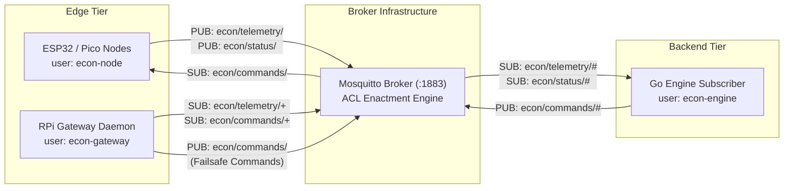

#### Access Control List (ACL) Specification (`server/mosquitto/acl`)
```text
user econ-engine
topic read econ/telemetry/#
topic read econ/status/#
topic write econ/commands/#

user econ-node
topic write econ/telemetry/#
topic write econ/status/#
topic read econ/commands/#

user econ-gateway
topic read econ/telemetry/#
topic read econ/status/#
topic readwrite econ/commands/#
```
*Security Impact:* An edge node compromised on the local network is mathematically restricted by the broker to publishing only its own telemetry/status and reading commands. It cannot inject commands to other relays, read adjacent zone sensors, or alter building setpoints.

---

### 4.2 MQTT Topic Hierarchy

| Topic Pattern | Direction | Publisher | Subscriber(s) | QoS | Retained | Description |
|:---|:---:|:---|:---|:---:|:---:|:---|
| `econ/telemetry/<ZONE_TOPIC>` | Pub | ESP32 / Pico / CV Node | Go Engine, RPi Gateway | 0 | False | Periodic and event-driven zone sensor telemetry. |
| `econ/commands/<ZONE_TOPIC>` | Pub | Go Engine / RPi Gateway | ESP32 / Pico Node | 0 | False | Actuation setpoints, lighting commands, plug commands. |
| `econ/status/<ZONE_TOPIC>` | Pub | ESP32 / Pico (LWT) | Go Engine, RPi Gateway | 0 | True | Node liveness status (`"online"` or `"offline"`). |
| `econ/status/gateway` | Pub | RPi Gateway (LWT) | Go Engine | 0 | True | Gateway liveness status (`"online"` or `"offline"`). |
| `econ/config/<ZONE_TOPIC>` | Pub | Go Engine / Operator | ESP32 Edge Node | 0 | True | Runtime configuration changes (calibration, voltages, intervals). |
| `econ/config/<ZONE_TOPIC>/state` | Pub | ESP32 Edge Node | Go Engine / Dashboard | 0 | True | Confirmed effective node configuration and active overrides. |

---

### 4.3 Dual-Mode Communications (`DualModeComm`)

Implemented in `edge/esp32/src/camera/dual_mode_comm.cpp`:
- **Primary Mode (Wi-Fi UDP Broadcast)**: Transmits lightweight datagrams on UDP port `4210` (`:4210`) with concurrent MQTT publishing. Provides low-overhead datagram streaming for edge person tracking (<0.2 ms non-blocking slice).
- **Secondary / Fallback Mode (USB CDC Serial)**: Zero-delay USB Serial JSON streaming (`115200` baud) when Wi-Fi is unassociated or broker connection fails.

---

### 4.4 JSON Payload Schemas & Concrete Examples

#### 1. Zone Telemetry Payload (`econ/telemetry/<ZONE_TOPIC>`)
```json
{
  "zone": "Level 4",
  "source": "esp32",
  "cfgRev": 0,
  "temperature": 24.2,
  "tempReal": true,
  "humidity": 55.4,
  "occupancy": 3,
  "confidence": 1.0,
  "person_count": 3,
  "co2": 620,
  "plugW": 145.2,
  "plug": "ON",
  "stripW": 85.0,
  "supplyC": 14.8,
  "acW": 650.0,
  "lux": 420.0,
  "lights": "ON",
  "setpoint": 23.0,
  "acReal": true
}
```

#### 2. Raw Fallback Telemetry Payload (Under Microcontroller CPU Strain)
When local DSP execution exceeds `DSP_TIME_BUDGET_US` (15 ms), the node bypasses local RMS calculations, decimates the 1200-sample ADC buffer down to 30 raw sample counts (`gRawStripSamples`), and offloads processing to the Go backend (`server/mqtt.go:164–176`):
```json
{
  "zone": "Level 4",
  "source": "esp32",
  "cfgRev": 0,
  "temperature": 24.2,
  "tempReal": true,
  "occupancy": 1,
  "rawFallback": true,
  "rawStripSamples": [
    1845, 1850, 1920, 2040, 2150, 2240, 2290, 2260, 2180, 2050,
    1910, 1820, 1780, 1790, 1840, 1930, 2060, 2170, 2250, 2280,
    2240, 2150, 2020, 1890, 1810, 1780, 1800, 1860, 1960, 2080
  ],
  "lights": "ON",
  "setpoint": 24.0,
  "acReal": true
}
```

#### 3. Actuation Command Tokens (`econ/commands/<ZONE_TOPIC>`)
Commands use tokenized semicolon-separated ASCII strings for minimal RAM overhead:
- Standard Optimizer Command: `"LIGHTS_ON;SETPOINT=22.5"`
- Vacancy Setback Command: `"LIGHTS_OFF;SETPOINT=26.0"`
- Plug-Load Shed Command (APLC): `"PLUG_OFF"`
- Autonomous Gateway Failsafe Command: `"LIGHTS_OFF;SETPOINT=28.0;SRC=FAILSAFE"`
- Custom Hex IR Blaster Code: `"IR_SEND:COOLIX:0xB27BE0:24"`
- CPU Strain Simulation Override: `"CPU_STRAIN:HIGH"` or `"CPU_STRAIN:NORMAL"`

---

### 4.5 Gateway Failsafe & Resiliency Mechanisms

```mermaid
sequenceDiagram
    participant ESP as ESP32 Edge Node
    participant Broker as Mosquitto MQTT Broker
    participant GW as Raspberry Pi Gateway (gateway.py)
    participant Engine as Go Engine (Brain)

    Note over ESP,Engine: Normal Operation (Engine Online)
    ESP->>Broker: econ/telemetry/zone_1 {"occupancy": 0, "temp": 24.5}
    Broker->>Engine: Deliver Telemetry
    Broker->>GW: Deliver Telemetry (Tracks vacant_since = now)
    Engine->>Broker: econ/commands/zone_1 "LIGHTS_OFF;SETPOINT=26.0"
    Broker->>ESP: Deliver Command
    Broker->>GW: Deliver Command (GW updates last_engine_cmd = now)

    Note over Engine: Central Brain Dies / Network Partition
    ESP->>Broker: econ/telemetry/zone_1 {"occupancy": 0}
    Broker->>GW: Deliver Telemetry (Zone remains vacant)
    Note over GW: Tick evaluates:<br/>1. (now - last_engine_cmd) > 10s (ENGINE OFFLINE)<br/>2. vacant_for > 30s (VACANCY PERSISTS)<br/>3. failsafe_active == false
    GW->>Broker: econ/commands/zone_1 "LIGHTS_OFF;SETPOINT=28.0;SRC=FAILSAFE"
    Broker->>ESP: Deliver Failsafe Command
    ESP->>ESP: Sets Lights OFF, Sets AC to 28.0°C Setback

    Note over ESP,GW: Recovery (Occupant Returns)
    ESP->>Broker: econ/telemetry/zone_1 {"occupancy": 1}
    Broker->>GW: Deliver Telemetry (occupancy > 0)
    Note over GW: GW clears failsafe_active = false,<br/>vacant_since = null
```

#### 1. Autonomous Gateway Failsafe Daemon (`edge/raspberry_pi/gateway.py:1–155`)
- **Architectural Role**: Hosted locally on the site Raspberry Pi alongside the Mosquitto broker. Acts as a local rules engine that DEFERS to the central Go engine as long as the engine is alive, but intervenes autonomously if the engine drops offline.
- **Engine Liveness Tracking**: Subscribes to `econ/commands/+`. Tracks `last_engine_cmd`. If `(now - last_engine_cmd) > ENGINE_TIMEOUT_S` (10.0 seconds), the engine is declared unreachable.
- **Vacancy Setback Delay**: Subscribes to `econ/telemetry/+`. When occupancy drops to $\le 0$, sets `vacant_since`. If vacancy persists for `FAILSAFE_DELAY_S` (30.0 seconds) while the engine is offline, the gateway publishes:
  `"LIGHTS_OFF;SETPOINT=28.0;SRC=FAILSAFE"`
- **Anti-Self-Trigger Tag (`FAILSAFE_TAG = ";SRC=FAILSAFE"`)**: The gateway checks `if FAILSAFE_TAG in payload: return` (line 91), ensuring it never mistakes its own failsafe command for an engine heartbeat.
- **Edge Command Parser Compatibility**: The ESP32 `handleCommand()` splits commands by `;`. Unknown tokens like `;SRC=FAILSAFE` are gracefully ignored while `LIGHTS_OFF` and `SETPOINT=28.0` are executed.
- **State Recovery**: As soon as telemetry with `occupancy > 0` arrives, `failsafe_active` resets to `false`, allowing seamless handback to the engine upon reconnection.

#### 2. Microcontroller Hardware Watchdogs
- **Raspberry Pi Pico (`edge/pico/main.py:251, 315, 338`)**: Initializes the RP2040 hardware watchdog timer with an 8-second timeout (`machine.WDT(timeout=8000)`). If USB CDC serial streaming or network socket reads freeze for $>8$ seconds, the chip executes a hard reboot.
- **ESP32 FreeRTOS Task Watchdog**: Monitored via the ESP-IDF Task Watchdog Timer (TWDT), triggering an automatic reboot if loop execution wedges.

---

## 5. Layer 3: Backend Engine & Simulation

### 5.1 30 FPS Physics Pipeline & Control Loops

The Go backend engine (`server/simulation/engine.go`) runs a continuous 30 Hz simulation loop ($\Delta t \approx 33.3\,\text{ms}$). It bridges first-principles physics with online machine learning, maintaining energy conservation across every zone.

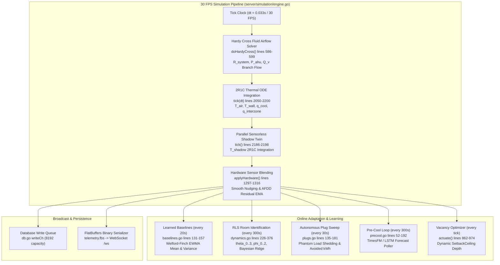

---

### 5.2 The 2R1C Lumped-Capacitance Thermodynamic Model

#### 5.2.1 Physical Formulation & Coupled Differential Equations
Each thermal zone is modeled as a 2-Resistor / 1-Capacitor equivalent circuit:
- Fast indoor air node ($T_{\text{air}}$) with thermal capacitance $C_{\text{air}}$ ($\text{J/K}$).
- Slow structural wall thermal mass ($T_{\text{wall}}$) with capacitance $C_{\text{wall}}$ ($\text{J/K}$).
- Inner boundary resistance $R_{\text{in}}$ ($\text{K/W}$) between air and interior wall surface.
- Outer envelope resistance $R_{\text{out}}$ ($\text{K/W}$) between wall mass and outdoor ambient air ($T_{\text{out}}$).

The coupled continuous-time differential equations governing the thermal state are:

$$\frac{dT_{\text{air}}}{dt} = \frac{1}{C_{\text{air}}} \left[ \frac{T_{\text{wall}} - T_{\text{air}}}{R_{\text{in}}} + \dot{q}_{\text{int}} + \dot{q}_{\text{interzone}} - \dot{q}_{\text{cool}} \right]$$

$$\frac{dT_{\text{wall}}}{dt} = \frac{1}{C_{\text{wall}}} \left[ \frac{T_{\text{out}} - T_{\text{wall}}}{R_{\text{out}}} - \frac{T_{\text{wall}} - T_{\text{air}}}{R_{\text{in}}} \right]$$

In state-space matrix notation $\dot{\mathbf{T}} = \mathbf{A}\mathbf{T} + \mathbf{b}$, where $\mathbf{T} = [\,T_{\text{air}},\, T_{\text{wall}}\,]^{\top}$:

$$\mathbf{A} = \begin{bmatrix} -\dfrac{1}{R_{\text{in}}C_{\text{air}}} & \dfrac{1}{R_{\text{in}}C_{\text{air}}} \\ \dfrac{1}{R_{\text{in}}C_{\text{wall}}} & -\dfrac{1}{C_{\text{wall}}}\left(\dfrac{1}{R_{\text{in}}}+\dfrac{1}{R_{\text{out}}}\right) \end{bmatrix}, \qquad \mathbf{b} = \begin{bmatrix} \dfrac{\dot{q}_{\text{int}} + \dot{q}_{\text{interzone}} - \dot{q}_{\text{cool}}}{C_{\text{air}}} \\ \dfrac{T_{\text{out}}}{R_{\text{out}}\,C_{\text{wall}}} \end{bmatrix}$$

#### 5.2.2 Parameter Derivation
1. **Air Thermal Capacitance ($C_{\text{air}}$)**:
   $$C_{\text{air}} = \kappa \cdot \rho_{\text{air}} c_{p,\text{air}} \cdot A_{\text{zone}} \cdot h_{\text{ceiling}}$$
   where $\rho_{\text{air}} c_{p,\text{air}} = 1206\,\text{J}\cdot\text{m}^{-3}\text{K}^{-1}$, and $\kappa = 5$ is a lump factor accounting for furniture, partitions, and shallow slab thermal mass.
2. **Wall Thermal Capacitance ($C_{\text{wall}}$)**:
   $$C_{\text{wall}} = \rho_{\text{concrete}} c_{p,\text{concrete}} \cdot V_{\text{envelope}} \approx 4 \times 10^6\,\text{J/K (default baseline)}$$
3. **Envelope Thermal Resistance ($R_{\text{in}}, R_{\text{out}}$)**:
   $$(UA)_{\text{zone}} = U_{\text{wall}} A_{\text{wall}} + U_{\text{roof}} A_{\text{roof}} + U_{\text{part}} A_{\text{part}}, \qquad R_{\text{total}} = \frac{1}{(UA)_{\text{zone}}}$$
   $$R_{\text{in}} = 0.40 \cdot R_{\text{total}}, \qquad R_{\text{out}} = 0.60 \cdot R_{\text{total}}$$
4. **Inter-Zone Partition Coupling ($\dot{q}_{\text{interzone}}$)**:
   $$\dot{q}_{\text{interzone}} = \sum_{j \in \text{Adjacent}} \frac{T_j - T_{\text{air}}}{R_{\text{part}, j}}, \qquad R_{\text{part}, j} = \max\Big(0.001,\; 2.0 \cdot (R_{\text{in}} + R_{\text{in}, j})\Big)$$

#### 5.2.3 VAV Sensible Cooling Capacity Normalization
Sensible cooling extraction $\dot{q}_{\text{cool}}$ is normalized by terminal VAV nominal design airflow:

$$\dot{q}_{\text{total,nom}} = \dot{q}_{\text{int,nom}} + \frac{T_{\text{out}} - T_{\text{sp}}}{R_{\text{in}} + R_{\text{out}}}$$

$$\dot{q}_{\text{cool}} = \max\left(0,\; \left(\frac{\dot{m}_{\text{vav}}}{\dot{m}_{\text{nom}}}\right) \cdot \dot{q}_{\text{total,nom}} \cdot \left(\frac{T_{\text{air}} - T_{\text{supply}}}{T_{\text{sp}} - T_{\text{supply}}}\right)\right)$$

where $\dot{m}_{\text{vav}} / \dot{m}_{\text{nom}}$ is the airflow ratio from the Hardy Cross solver, and $T_{\text{supply}}$ is either measured via DS18B20 or taken from design ($12.0^\circ\text{C}$). The non-negative clamp prevents cooling air from heating zones.

#### 5.2.4 Numerical Integration & Stability Criterion
Integration uses an explicit Forward Euler discretization:

$$T_{\text{air}}^{(k+1)} = T_{\text{air}}^{(k)} + \left[ \frac{T_{\text{wall}}^{(k)} - T_{\text{air}}^{(k)}}{R_{\text{in}} C_{\text{air}}} + \frac{\dot{q}_{\text{int}} + \dot{q}_{\text{interzone}} - \dot{q}_{\text{cool}}}{C_{\text{air}}} \right] \Delta t$$

$$T_{\text{wall}}^{(k+1)} = T_{\text{wall}}^{(k)} + \left[ \frac{T_{\text{out}} - T_{\text{wall}}^{(k)}}{R_{\text{out}} C_{\text{wall}}} - \frac{T_{\text{wall}}^{(k)} - T_{\text{air}}^{(k)}}{R_{\text{in}} C_{\text{wall}}} \right] \Delta t$$

**Stability Bound**: The spectral radius requires $\Delta t < 2 R_{\text{in}} C_{\text{air}} = 2 \tau_{\text{air}}$. At $\Delta t \approx 0.033\,\text{s}$, the solver operates orders of magnitude inside the stability threshold ($\tau_{\text{air}} \sim 600 - 3600\,\text{s}$). State values are clamped to $[5.0^\circ\text{C}, 50.0^\circ\text{C}]$.

- **Source Reference**: `server/simulation/engine.go:2050–2200` (`tick()`).
- **Mathematical Specification**: `PAPER.md:400–493` (§7.1, §7.2).

---

### 5.3 Hardy Cross Fluid Airflow Simulation

#### 5.3.1 Looped Formulation & Closed-Form Star Reduction
Turbulent head loss $h$ across duct segments obeys the Atkinson equation $h = K \cdot Q^2$. In ECON's parallel VAV star network, $V$ parallel branches share a common supply plenum pressure drop $\Delta P = P_{\text{ahu}}$. The looped Newton-Raphson formulation reduces to an exact closed-form algebraic solution:

Each branch carries airflow:
$$Q_v = \sqrt{\frac{\Delta P}{K_v}} \implies K_v^{-1/2} = \frac{Q_v}{\sqrt{\Delta P}}$$

Summing across all $V$ branches yields total airflow $Q_{\text{tot}} = \sqrt{\Delta P} \sum K_v^{-1/2}$. Inverting yields equivalent system resistance $R_{\text{system}}$:

$$R_{\text{system}} = \left( \sum_{v=1}^V K_v^{-1/2} \right)^{-2} = \left( \sum_{v=1}^V \frac{1}{\sqrt{K_v}} \right)^{-2}$$

Coupling with the supply fan curve ($P_{\max}$ split between fan resistance $K_{\text{fan}}$ and $R_{\text{system}}$):

$$Q_{\text{tot}}^2 = \frac{P_{\max}}{K_{\text{fan}} + R_{\text{system}}}$$

Static operating pressure at the AHU plenum is:

$$\Delta P = P_{\text{ahu}} = R_{\text{system}} \cdot Q_{\text{tot}}^2 = R_{\text{system}} \cdot \left(\frac{P_{\max}}{K_{\text{fan}} + R_{\text{system}}}\right)$$

Individual branch flows are directly extracted:

$$Q_v = \sqrt{\frac{\max(0, P_{\text{ahu}})}{K_v}}$$

#### 5.3.2 Fan Sizing & Static Pressure Ceiling
The fan sizing function `sizeFanToBuilding()` sets:
$$P_{\max} = P_{\text{design}} \cdot \left( \frac{K_{\text{fan}}}{R_{\text{system, design}}} + 1.0 \right)$$
Static pressure is clamped to a physical safety ceiling: $P_{\text{ahu}} \le 650.0\,\text{Pa}$. When a VAV damper closes, $R_{\text{system}}$ rises, increasing plenum pressure and redistributing airflow into adjacent open zones.

- **Source Reference**: `server/simulation/engine.go:570–599` (`sizeFanToBuilding()`, `doHardyCross()`).
- **Mathematical Specification**: `PAPER.md:494–524` (§7.3).

---

### 5.4 Recursive Least Squares (RLS) Online Room Dynamics

#### 5.4.1 System Identification Formulation
Implemented in `server/simulation/dynamics.go:1–989`. Identifies physical room parameters online by regressing two continuous differential equations:

1. **Thermal Response ODE**:
   $$\frac{dT}{dt} = \theta_0 (T_{\text{out}} - T_{\text{in}}) + \theta_1 \cdot \text{FlowRatio} \cdot (T_{\text{in}} - T_{\text{supply}}) + \theta_2 \cdot N_{\text{occ}} + \theta_3$$
   - $\theta_0$: Envelope thermal conductance ($h^{-1}$); thermal time constant $\tau = 1/\theta_0$ (hours).
   - $\theta_1$: VAV cooling authority ($h^{-1}$ per unit flow $\cdot \Delta T$); physically $< 0$.
   - $\theta_2$: Heat gain per occupant ($^\circ\text{C}/h$ per person); physically $\ge 0$.
   - $\theta_3$: Unmetered base electrical and solar load ($^\circ\text{C}/h$).

2. **Ventilation & CO₂ Mass Balance ODE**:
   $$\frac{dC}{dt} = \phi_0 \cdot N_{\text{occ}} + \phi_1 (C_{\text{out}} - C) + \phi_2$$
   - $\phi_0$: CO₂ generation rate per person ($\text{ppm}/h$ per person).
   - $\phi_1$: Air-change rate ACH ($h^{-1}$); physically $> 0$.
   - $\phi_2$: Ambient baseline drift ($\text{ppm}/h$).

#### 5.4.2 Midpoint Bias Cancellation & Errors-in-Variables
Sampling occurs at $\Delta t_{\text{sample}} = 300\,\text{s}$ (5 minutes). Evaluating target derivative $y = (T_t - T_{t-1})/\Delta t$ against endpoint $T_t$ introduces measurement error $-\varepsilon_t$, creating spurious negative terms in covariance. ECON evaluates regressors at the **interval midpoint**:

$$T_{\text{mid}} = \frac{T_t + T_{t-1}}{2}, \qquad C_{\text{mid}} = \frac{C_t + C_{t-1}}{2}$$

This cancels correlated noise expectation $\mathbb{E}[\varepsilon_t^2 - \varepsilon_{t-1}^2]/(2\Delta t) = 0$, eliminating asymptotic bias.

#### 5.4.3 RLS Update Equations & Anti-Windup
1. Information Metric: $\text{info} = \mathbf{x}^\top P \mathbf{x}$.
2. Information-Gated Forgetting: $\lambda = 0.999$ if $\text{info} \ge 10^{-3}$; else $\lambda = 1.000$ (prevents covariance windup during steady state).
3. Gain Vector: $\mathbf{k} = \frac{P \mathbf{x}}{\lambda + \mathbf{x}^\top P \mathbf{x}}$.
4. Parameter & Covariance Update:
   $$\theta \leftarrow \theta + \mathbf{k}(y - \mathbf{x}^\top \theta), \qquad P \leftarrow \frac{1}{\lambda}\left(P - \mathbf{k}\mathbf{x}^\top P\right)$$
5. Trace Bounding: If $\text{trace}(P) > 10^4$, rescales $P \leftarrow P \cdot \frac{10^4}{\text{trace}(P)}$.
6. Bayesian Ridge Prior (Leaky RLS): Relaxes unconstrained parameters toward physical prior $\theta_{\text{prior}} = [0.5, -1.0, 0.05, 0.2]^\top$:
   $$w_i = \text{clamp}\left(\frac{P_{ii}}{50.0},\, 0,\, 1\right), \qquad \theta_i \leftarrow \theta_i + 0.002 \cdot w_i \cdot (\theta_{\text{prior}, i} - \theta_i)$$

#### 5.4.4 Closed-Form Forward Trajectory Projection
With drivers held constant, the ODE integrates analytically:

$$k = \theta_0 - \theta_1 \cdot \text{FlowRatio}, \qquad T_{\text{eq}} = \frac{\theta_0 T_{\text{out}} - \theta_1 \cdot \text{FlowRatio} \cdot T_{\text{supply}} + \theta_2 N_{\text{occ}} + \theta_3}{k}$$

$$T(t) = T_{\text{eq}} + \big(T(0) - T_{\text{eq}}\big) e^{-k t}$$

Time required to cross comfort limit $T_{\text{limit}}$:

$$t_{\text{limit}} = -\frac{1}{k} \ln\left(\frac{T_{\text{limit}} - T_{\text{eq}}}{T(0) - T_{\text{eq}}}\right) \times 3600\,\text{seconds}$$

- **Source Reference**: `server/simulation/dynamics.go:1–989`, `recommend.go:299–409`.

---

### 5.5 Learned Operating Baselines & Anomaly Scoring

#### 5.5.1 Online Welford/Finch Mean and Variance Estimator
Implemented in `server/simulation/baselines.go:1–413`. Maintains online statistics per `(zone, metric, hour)`:
- Sample count $n$
- Running mean $\mu_n$
- Running variance $\sigma_n^2$

On arrival of reading $x$ (sampled every 20 seconds):

$$\alpha = \max\left(\frac{1}{n},\; 0.04\right), \qquad d = x - \mu_{n-1}$$

$$\mu_n = \mu_{n-1} + \alpha \cdot d, \qquad \sigma_n^2 = (1 - \alpha) \big( \sigma_{n-1}^2 + \alpha \cdot d^2 \big)$$

#### 5.5.2 Diurnal Partitioning & Maturity Hierarchy
- **Buckets**: 24 clock-hour buckets ($0..23$) plus an all-hours pooled bucket ($24$).
- **Maturity**: Mature when $n \ge 20$ samples.
- **Hierarchy**: Clock-hour bucket $\to$ Pooled bucket $\to$ Recognized standard (ASHRAE 62.1).

#### 5.5.3 Anomaly Scoring & Threshold Table
Anomaly score: $z = \frac{x - \mu}{\max(\sigma, \sigma_{\min})}$.

| Metric | $\sigma_{\min}$ | $z_{\text{alert}}$ | High Bad | Standard Fallback Floor | Action Trigger |
|:---|:---|:---|:---|:---|:---|
| `temp` | $0.4^\circ\text{C}$ | $+3.5\sigma$ | Yes | None (purely learned) | `cool` |
| `co2` | $40\,\text{ppm}$ | $+3.0\sigma$ | Yes | $1000\,\text{ppm}$ (ASHRAE) | `purge` |
| `occupancy` | $0.5\,\text{pax}$ | $-1.5\sigma$ | No | $0\,\text{pax}$ (zero-check) | `turn_off_ac` |
| `buildingLoadMw` | $0.05\,\text{MW}$ | $+1.5\sigma$ | Yes | None | `precool` |
| `plugKw` | $0.3\,\text{kW}$ | $+3.0\sigma$ | Yes | None | Advisory |

- **Source Reference**: `server/simulation/baselines.go:1–413`, `recommend.go:128–269`.

---

### 5.6 Autonomous Plug-Load Controller (APLC)

#### 5.6.1 Physical Modeling & Sweep Loop
Implemented in `server/simulation/plugs.go:1–306` and `server/plugapi.go:1–178`. Plug demand is modeled as:

$$P_{\text{plug}} = P_{\text{standby}} + N_{\text{occ}} \cdot P_{\text{active,occ}}$$

where $P_{\text{active,occ}} = 65.0\,\text{W}$ and $P_{\text{standby}} = 1.2\,\text{W/m}^2 \cdot A_{\text{zone}}$. Switchable fraction $f_{\text{switch}} = 0.70$ (70% non-critical sockets; 30% critical appliances).

#### 5.6.2 Actuation & Avoided Carbon Integration
- **Window**: Armed outside operating hours (default 19:00 to 07:00).
- **Safety Dwell**: Zone must be vacant for `GraceMinutes = 15`. Server rooms and comms closets are excluded (`isZoneCritical`).
- **Actuation**: Dispatches `PLUG_OFF` over MQTT. Standby power drops by 70%.
- **Energy Avoided**: Integrated continuously:
  $$\Delta E_{\text{saved}} = \frac{P_{\text{standby}} \cdot f_{\text{switch}} \cdot \Delta t}{3.6 \times 10^6}\,\text{kWh}$$

---

### 5.7 Forecast-Driven Pre-Cool Decision Loop

Implemented in `server/precool.go:1–226` and `server/simulation/engine.go:892, 938–942`.
1. Runs every 5 minutes (`precoolLoop`).
2. Queries the **Google TimesFM** zero-shot model (12-step / 60-min lookahead) via `queryTimesFM()`; falls back to **PeakLoadLSTM** via `queryLSTM()`.
3. **Plausibility Gate**: Clamps against observed load range $[L_{\min}, L_{\max}]$. Rejects foreign building weights.
4. **Trigger Threshold**: Evaluates baseline with 30-minute lead:
   $$L_{\text{thresh}} = \mu_{\text{load}}(t + 30\,\text{min}) + 1.5 \cdot \sigma_{\text{load}}(t + 30\,\text{min})$$
5. **Actuation**: If $\hat{P}_{\text{peak}} \ge L_{\text{thresh}}$, opens a 20-minute pre-cooling window, depressing active setpoints by $-1.5^\circ\text{C}$ to charge concrete thermal mass ($C_{\text{wall}}$) before peak electrical tariffs hit.

---

### 5.8 Vacancy Setback Optimizer

Implemented in `server/simulation/engine.go:862–974` and `server/simulation/dynamics.go:879–950`.
1. **Manual Override Latch**: Respects manual human changes (`z.OverrideUntil`) for 15 minutes.
2. **Vacancy Dwell**: Requires 90 consecutive vacant ticks ($\approx 3.0\,\text{s}$ at 30 FPS).
3. **Dynamic Setback Depth via `SetbackCeiling()`**: Rather than a flat setback, calculates the maximum setback $\Delta T_{\text{sb}}$ such that full cooling can recover to setpoint within 30 minutes ($t_{\text{recover}} = 1800\,\text{s}$):
   $$k_{\text{rec}} = \theta_0 - \theta_1, \qquad T_{\text{eq,full}} = \frac{\theta_0 T_{\text{out}} - \theta_1 T_{\text{supply}} + \theta_3}{k_{\text{rec}}}$$
   $$T_{\text{sb,max}} = T_{\text{eq,full}} + \big(T_{\text{sp,base}} - T_{\text{eq,full}}\big) e^{k_{\text{rec}} \cdot t_{\text{recover}}}$$
   $$\Delta T_{\text{sb}} = \text{clamp}\big(T_{\text{sb,max}} - T_{\text{sp,base}} - 0.5^\circ\text{C},\; 1.5^\circ\text{C},\; 6.0^\circ\text{C}\big)$$

---

### 5.9 Automated Fault Detection and Diagnostics (AFDD)

Implemented in `server/simulation/engine.go:125–135, 1308–1316, 2186–2198`, `recommend.go:320–408`, and `carbon.go:420–530`.
1. **Sensorless Shadow Twin**: Every zone bound to hardware runs a parallel, sensor-free 2R1C simulation. It is never pulled toward physical measurements.
2. **Residual Tracking**: Raw residual $r = |T_{\text{hw}} - T_{\text{shadow}}|$ is filtered via an Exponential Moving Average ($\alpha = 0.02$):
   $$\text{ResidualEma} \leftarrow \text{ResidualEma} + 0.02 \cdot \big(r - \text{ResidualEma}\big)$$
3. **Alert Triggering**: When $\text{ResidualEma} > 2.0^\circ\text{C}$, asserts `AfddAlert = true` (flags stuck dampers, fouled coils, or sensor drift).
4. **Capability Shortfall**: Flags when full cooling equilibrium $T_{\text{eq,full}} > T_{\text{sp}} + 0.8^\circ\text{C}$ (*"Undersized VAV / delivery fault"*).

---

## 6. Layer 4: AI/ML & Forecasting

### 6.1 Machine Learning Architecture & IPC Topology

Layer 4 integrates deep learning models running in a dedicated Python FastAPI microservice (`backend/forecasting/`) with the Go backend engine (`server/forecast.go`).

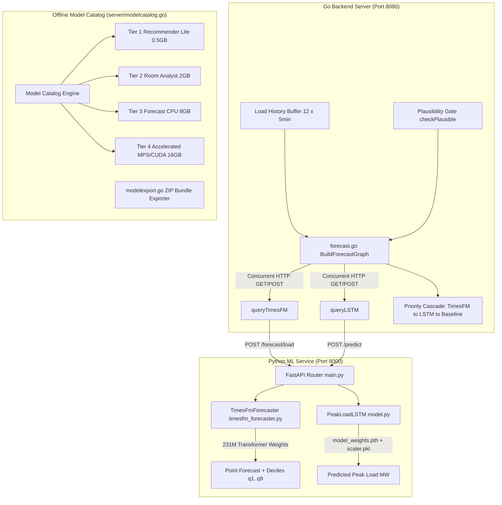

---

### 6.2 Supervised PeakLoadLSTM Architecture

- **Implementation**: `backend/forecasting/model.py:5–22`, `config.py:8–23`, `train.py:75–134`.
- **Model Architecture**:
  ```python
  class PeakLoadLSTM(nn.Module):
      def __init__(self, input_size=4, hidden_size=64, num_layers=2, output_size=1):
          super().__init__()
          self.lstm = nn.LSTM(input_size, hidden_size, num_layers, batch_first=True)
          self.fc = nn.Linear(hidden_size, output_size)

      def forward(self, x):
          out, _ = self.lstm(x)
          return self.fc(out[:, -1, :])
  ```
- **Input Features**: `["room_temp", "airflow", "outdoor_temp", "outdoor_humidity"]` (sequence length: 12 steps = 1 hour rolling window).
- **Training Source**: 14-day history from TimescaleDB continuous aggregate `sensor_readings_5m`. If $<200$ windows exist, generates 6,000 synthetic physics trajectories using the plant COP equation (`train.py:54–73`).
- **Honest Serving**: If `model_weights.pth` or `scaler.pkl` is absent, `POST /predict` returns HTTP 503 rather than fabricating estimates.

---

### 6.3 Google TimesFM Zero-Shot Foundation Model

- **Implementation**: `backend/forecasting/timesfm_forecaster.py:1–270`, `main.py:97–145`.
- **Model Candidates**: Probes Hugging Face for `google/timesfm-2.5-200m-transformers` (231M parameters, primary) and `google/timesfm-2.0-500m-pytorch` (500M parameters, fallback).
- **Hardware Acceleration**: Dynamically binds to `cuda` (NVIDIA), `mps` (Apple Silicon Metal Performance Shaders), or falls back to `cpu` (`pick_device()`).
- **Zero-Shot Inference**: Requires $\ge 8$ historical 5-minute load observations. Forecasts 12 steps (1 hour) into the future without building-specific retraining.
- **Quantile Risk Bands**: Outputs mean point trajectory plus 9 decile quantiles (`q1` through `q9`). Enables risk-averse pre-cooling based on the 90th percentile peak risk ($q9$).

---

### 6.4 Go-to-Python IPC, Concurrency & Plausibility Auditing

Implemented in `server/forecast.go:44–126, 182–226, 594–681`:
- **Concurrent Dispatch**: `BuildForecastGraph()` queries `queryTimesFM` (180s cold-start timeout) and `queryLSTM` (2–8s timeout) concurrently across Go channels.
- **Plausibility Auditing (`checkPlausible()`)**: Compares predicted peak against the building's historical load range $[L_{\min}, L_{\max}]$. If $\hat{P} > 4.0 \cdot L_{\max}$, rejects the forecast as out-of-distribution.
- **Priority Cascade**:
  1. *Primary*: Google TimesFM zero-shot trajectory with decile quantile bands ($q9$).
  2. *Secondary*: Supervised LSTM peak with honest persistence trajectory.
  3. *Fallback*: Physical persistence baseline with honest statistical uncertainty bounds.

---

### 6.5 Local Model Catalog & Offline Export Tiers

Implemented in `server/modelcatalog.go:1–353` and `server/modelexport.go:1–305`. Profiles client hardware via browser capabilities (`POST /api/model/recommend`) to match user devices to downloadable local AI runtimes:
- **Tier 1 — Recommender (Lite)**: Standard Python library only (0.5 GB RAM, 1 core). $\sigma$-scores readings against learned baselines.
- **Tier 2 — Room Analyst**: Standard Python library (2 GB RAM, 2 cores). Solves closed-form room dynamics and time-to-breach.
- **Tier 3 — Forecast (CPU)**: Python + PyTorch + Transformers (8 GB RAM, 4 cores). Runs TimesFM (231M) and LSTM on CPU.
- **Tier 4 — Forecast (Accelerated)**: PyTorch with Apple Silicon MPS or NVIDIA CUDA (16 GB RAM, 8 cores). Runs GPU-accelerated TimesFM and Monte Carlo scenario sweeps.

Bundled as a standalone downloadable ZIP archive via `GET /api/model/export`.

---

## 7. Layer 5: Database & Persistence

### 7.1 Database Engine & TimescaleDB Hypertable Schema

ECON uses PostgreSQL 16 with the TimescaleDB extension for time-series persistence (`server/db/init.sql`, `server/db.go:migrateSchema()`).

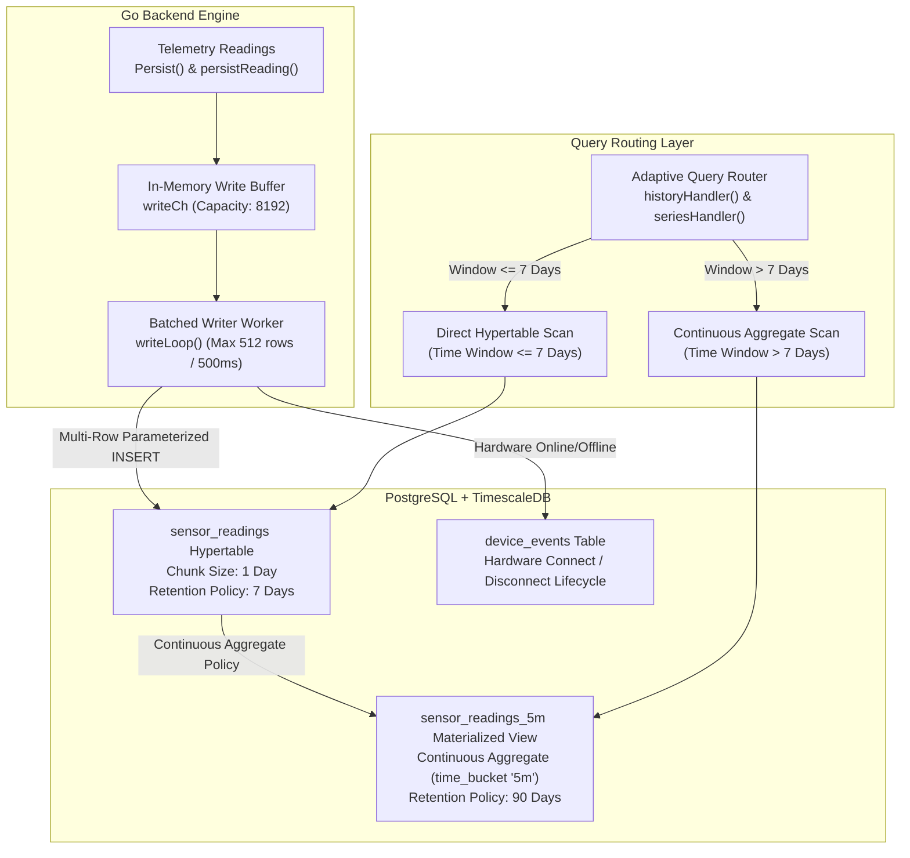

#### SQL Schema Definition
```sql
-- 1. Main Time-Series Hypertable
CREATE TABLE sensor_readings (
  time        TIMESTAMPTZ NOT NULL,
  zone_id     TEXT NOT NULL,
  sensor_type TEXT NOT NULL,
  value       DOUBLE PRECISION,
  device_id   TEXT,
  quality     TEXT,              -- 'measured' | 'modelled' | 'derived'
  strip_w     DOUBLE PRECISION
);
SELECT create_hypertable('sensor_readings', 'time');
CREATE INDEX ON sensor_readings (zone_id, time DESC);
CREATE INDEX ON sensor_readings (device_id, time DESC);

-- 2. Hardware Lifecycle Events Table
CREATE TABLE device_events (
  time      TIMESTAMPTZ NOT NULL,
  device_id TEXT NOT NULL,
  event     TEXT NOT NULL,       -- 'online' | 'offline' | 'malformed'
  detail    TEXT
);

-- 3. 5-Minute Continuous Aggregate Materialized View
CREATE MATERIALIZED VIEW sensor_readings_5m
WITH (timescaledb.continuous) AS
SELECT time_bucket('5 minutes', time) AS bucket,
       zone_id,
       sensor_type,
       AVG(value) as avg_value
FROM sensor_readings
GROUP BY bucket, zone_id, sensor_type;

-- 4. Automated Retention Policies
SELECT add_continuous_aggregate_policy('sensor_readings_5m',
    start_offset => INTERVAL '1 month',
    end_offset => INTERVAL '5 minutes',
    schedule_interval => INTERVAL '5 minutes');

SELECT add_retention_policy('sensor_readings', INTERVAL '7 days');
SELECT add_retention_policy('sensor_readings_5m', INTERVAL '90 days');
```

---

### 7.2 High-Throughput Asynchronous Ingestion Pipeline

To prevent database disk latency from blocking the 30 FPS physics ticker:
1. `engine.Persist(zoneId, sensorType, value)` enqueues records into Go channel `writeCh` (capacity 8192). If the channel saturates, records are dropped gracefully.
2. Background goroutine `writeLoop()` (`server/db.go:164–216`) drains `writeCh`. It flushes batched multi-row inserts when `maxBatch = 512` is reached or every 500 ms on a ticker.
3. Multi-row parameterized SQL is executed in single transactions:
   `INSERT INTO sensor_readings (time, zone_id, sensor_type, value, device_id, quality, strip_w) VALUES ($1,$2,...), ($8,$9,...)`

---

### 7.3 Dynamic Historical Query Routing

Implemented in `server/db.go:218–399` (`historyHandler()`, `seriesHandler()`):
- **Window $\le 7$ days**: Queries raw hypertable `sensor_readings` using `time_bucket('1 second', time)` or calculated intervals.
- **Window $> 7$ days**: Dynamically routes to continuous aggregate view `sensor_readings_5m` using `time_bucket(interval, bucket)`, avoiding table scans across millions of rows.

---

### 7.4 Durable JSON State Checkpointing

In addition to TimescaleDB, the engine maintains durable JSON snapshots in `server/data/` for models requiring persistence across restarts:
- `data/baseline-model.json`: Hourly mean/variance stats (`baselines.go`).
- `data/room-dynamics.json`: Identified RLS parameters ($\theta, \phi, P$) (`dynamics.go`).
- `data/load-history.json`: 5-minute rolling building load context for TimesFM (`forecast.go`).
- `data/plug-state.json`: APLC cumulative saved kWh and configuration (`plugapi.go`).
- `data/sustainability-state.json`: Scope 2 emissions and equipment runtimes (`carbon.go`).
- **Checkpoint Loops**: Goroutines flush changes to disk once every 60 seconds.

---

## 8. Layer 6: API Layer & Real-Time Communication

### 8.1 API Architecture & Security Model

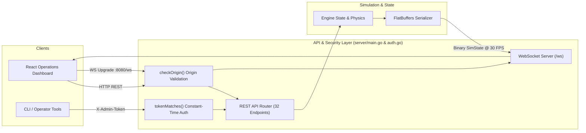

- **Cross-Site WebSocket Hijacking (CSWSH) Protection (`server/auth.go:checkOrigin`)**: Validates the `Origin` header against `Host`, loopback addresses, or `ECON_ALLOWED_ORIGINS`.
- **Constant-Time Token Authentication (`server/auth.go:tokenMatches`)**: Compares incoming admin tokens via `subtle.ConstantTimeCompare` against `ECON_ADMIN_TOKEN` to prevent timing attacks.
- **Role-Based WebSocket Execution**: Unauthenticated WebSocket connections stream telemetry read-only; administrative control actions (`"action": "auth"`) require passing a valid token.

---

### 8.2 Master Catalog of 32 REST API Endpoints

The Go backend exposes 32 REST endpoints across simulation, hardware inspection, recommendations, and carbon metrics.

| # | Endpoint | Method | Source File & Line | Auth Required | Functional Description |
|:---:|:---|:---:|:---|:---:|:---|
| **1** | `/api/building-data` | GET | `server/main.go:26` | No | Building geometry, zones, coordinates, and VAV mappings. |
| **2** | `/api/building/switch` | POST | `server/main.go:29`, `modelswitch.go:13` | Yes | Hot-reloads building context (e.g. `home`, `office`). |
| **3** | `/api/model/switch` | POST | `server/main.go:30`, `modelswitch.go:13` | Yes | Alias for building context switch. |
| **4** | `/api/ontology` | GET | `server/main.go:33` | No | Brick Schema ontology semantic graph (TTL / JSON). |
| **5** | `/api/library` | GET | `server/main.go:47` | No | Programme library thermal and design coefficients. |
| **6** | `/api/history` | GET | `server/main.go:58`, `db.go:218` | No | TimescaleDB power, CO₂, and occupancy historical series. |
| **7** | `/api/series` | GET | `server/main.go:66`, `db.go:329` | No | Parameterized time series for any metric (e.g. `afddResidual`). |
| **8** | `/api/forecast` | GET/POST | `server/main.go:69`, `forecast.go:43` | No | Supervised LSTM 24-step peak electrical load forecast. |
| **9** | `/api/forecast/load` | GET | `server/main.go:166`, `forecast.go:193`| No | Google TimesFM zero-shot foundation model load forecast. |
| **10**| `/api/forecast/engines` | GET | `server/main.go:167`, `forecast.go:269`| No | Health and readiness status of forecast engines. |
| **11**| `/api/forecast/compare` | GET | `server/main.go:173`, `forecast.go:318`| No | Side-by-side comparison of LSTM vs TimesFM forecasts. |
| **12**| `/api/hardware` | GET | `server/main.go:73` | No | Live status and telemetry of edge IoT nodes (ESP32/Pico). |
| **13**| `/api/vision/detection` | POST| `server/main.go:80` | No | Injects camera-detected AC brand/protocol frame. |
| **14**| `/api/command` | POST| `server/main.go:102`, `main.go:355` | No | Manual HVAC/lights override (`HVAC_SET`, `SETPOINT`). |
| **15**| `/api/devices` | GET | `server/devices.go:412` | No | Hardware diagnostic inspector table and device statuses. |
| **16**| `/api/devices/series` | GET | `server/devices.go:413` | No | Device-attributed telemetry series. |
| **17**| `/api/devices/events` | GET | `server/devices.go:414` | No | Edge node connect, disconnect, and error event audit log. |
| **18**| `/api/devices/quality` | GET | `server/devices.go:415` | No | Sensor data quality breakdown (measured vs modeled). |
| **19**| `/api/precool` | GET/POST | `server/main.go:116`, `precool.go:197` | No | Pre-cool window status / manual window trigger. |
| **20**| `/api/weather` | GET | `server/main.go:120`, `weather.go:72` | No | Open-Meteo live outdoor temp and fallback status. |
| **21**| `/api/digitize` | POST| `server/main.go:126`, `blueprint.go:67`| No | Uploads architectural plan for ML digitizer parsing. |
| **22**| `/api/building` | POST| `server/main.go:127`, `blueprint.go:94`| Yes | Deploys digitized blueprint to active digital twin. |
| **23**| `/api/building/backups`| GET | `server/main.go:128`, `blueprint.go:142`| No | Lists historical building model backups. |
| **24**| `/api/building/rollback`| POST| `server/main.go:129`, `blueprint.go:159`| Yes | Reverts active model to a historical backup. |
| **25**| `/api/plugs` | GET/POST | `server/main.go:135`, `plugapi.go:18` | Guarded POST | APLC status, phantom leaderboard, and policy update. |
| **26**| `/api/recommendations` | GET | `server/main.go:142`, `recommendapi.go:120` | No | Ranked AI operational recommendations and baselines. |
| **27**| `/api/rooms/models` | GET | `server/main.go:151`, `simulation/dynamics.go` | No | Identified RLS physical room parameters per zone. |
| **28**| `/api/model` | GET | `server/main.go:158`, `modelexport.go:16`| No | Metadata on exportable offline model bundle. |
| **29**| `/api/model/export` | GET | `server/main.go:159`, `modelexport.go:35`| No | Downloads offline model bundle ZIP package. |
| **30**| `/api/model/recommend`| GET | `server/main.go:160`, `modelcatalog.go:122` | No | Machine sizing recommendation for local models. |
| **31**| `/api/sustainability` | GET | `server/main.go:179`, `carbon.go:463` | No | Scope 2 carbon, space utilization, and carbon offsets. |
| **32**| `/ws` | GET (Upgrade)| `server/main.go:193`, `main.go:211` | Yes (for control) | High-speed binary FlatBuffers telemetry stream at 30 Hz. |

---

### 8.3 WebSocket Streaming Protocol & Binary Frames

- **Endpoint**: `/ws`
- **Protocol**: Binary WebSocket frame carrying Google FlatBuffers bytes (`Telemetry.SimState`).
- **Cadence**: Broadcast at ~30 Hz driven by the engine ticker (`server/simulation/engine.go:2713–2856`).
- **Frame Schema (`server/schema/telemetry.fbs`)**:
  - `ZoneData`: Zone ID, temperature, setpoint, deadband, occupants, electrical load, lighting state, humidity, CO₂, plug watts, plug shed flag, supply temperature, power strip watts, AFDD residual.
  - `VavData`: Damper position, airflow rate.
  - `GlobalData`: Total building load ($MW$), cooling output ($MW$), plant COP, energy saved ($MW$), BESS state of charge ($SOC\%$), average CO₂, total plug load ($kW$), auto-pilot status, AHU static pressure ($Pa$).
  - Root `SimState`: Vectors of `ZoneData`, `VavData`, and `GlobalData` with epoch millisecond timestamp.
- **Non-Blocking Dispatch**: Finished byte buffers are broadcast asynchronously outside the engine lock to prevent network lag from stalling simulation physics.

---

## 9. Layer 7: Frontend Dashboard

### 9.1 Component Hierarchy & State Flow

The dashboard (`dashboard/`) is a high-performance single-page web application built with **React 18**, **Vite 5**, **Three.js / React Three Fiber**, and **Recharts**.

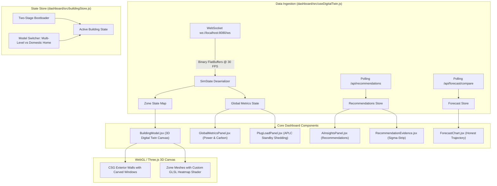

---

### 9.2 Procedural BIM 3D Digital Twin & Custom GLSL Heatmap Shader

Implemented in `dashboard/src/BuildingModel.jsx:1–799`:
1. **Constructive Solid Geometry (CSG) Window Cutouts**:
   Uses `three-bvh-csg` (`Evaluator`, `Brush`, `SUBTRACTION`, lines 12–43) to carve window openings directly out of exterior walls. An in-memory geometry cache (`_geometryCache`) keys on wall dimensions to reduce CSG tessellation overhead across identical floor plates by $3\times$.
2. **Custom GLSL Thermal Heatmap Shader Material (`ZoneRenderer`, lines 319–407)**:
   Each zone polygon is extruded via `THREE.ExtrudeGeometry` (depth: 3.8 m) and rendered using a custom GLSL fragment shader:
   ```glsl
   vec3 heatmap(float deviation) {
     float amount = clamp(deviation, -1.0, 3.0);
     vec3 cool = vec3(0.0, 0.5, 1.0);  // Blue: Overcooled
     vec3 good = vec3(0.0, 1.0, 0.0);  // Green: Optimal
     vec3 warn = vec3(1.0, 1.0, 0.0);  // Yellow: Warning
     vec3 hot  = vec3(1.0, 0.0, 0.0);  // Red: Critical Overheat
     
     if (amount < 0.0) return mix(good, cool, -amount);
     if (amount < 1.0) return mix(good, warn, amount);
     return mix(warn, hot, min(1.0, amount - 1.0));
   }
   
   void main() {
     float deviation = (temperature - setpoint) / deadband;
     vec3 heatColor = heatmap(deviation);
     vec3 physColor = vec3(0.2, 0.2, 0.2);
     vec3 finalColor = mix(heatColor, physColor, isPhysical);
     finalColor *= mix(0.3, 1.0, lightsOn); // Vacancy setback dims zone
     float finalOpacity = mix(opacity, opacity * 0.1, isPhysical);
     gl_FragColor = vec4(finalColor, finalOpacity);
   }
   ```
3. **Frame Optimization (`useFrame`, lines 415–433)**: Only active and alarmed zones execute `THREE.MathUtils.lerp` every frame (60 FPS). Inactive background zones snap only when telemetry changes by $>0.05^\circ\text{C}$, preventing frame drops across 1,350 zones.

---

### 9.3 Predictive Forecast Visualization

Implemented in `dashboard/src/ForecastChart.jsx:1–398`:
- **Honest Data Discipline**: Eliminates synthetic cubic curves. If `series` is empty or null, renders an explicit fallback:
  `<div data-testid="forecast-insufficient-data">Insufficient data — awaiting model telemetry</div>` (lines 110–145).
- **Trajectory & Uncertainty Bands (lines 150–260)**:
  - `<Line dataKey="mw" stroke="var(--accent-blue)" ...>`: TimesFM zero-shot point trajectory.
  - `<Line dataKey="hi" stroke="var(--accent-yellow)" strokeDasharray="3 3" ...>`: Upper decile ($q9$) uncertainty head.
  - `<ReferenceLine y={lstmPeak} stroke="var(--accent-purple)" strokeDasharray="4 4" ...>`: Supervised LSTM peak load reference benchmark.

---

### 9.4 Operational Telemetry Panels & AI Insights

- **Power & Carbon Metrics (`GlobalMetricsPanel.jsx:1–624`)**: Displays whole-building electrical load ($MW$), thermal cooling output ($MW$), chiller COP, energy saved ($MW$), BESS battery status, and Scope 2 operational emissions ($kg\,\text{CO}_2\text{e}$).
- **APLC Plug-Load Panel (`PlugLoadPanel.jsx:1–320`)**: Quantifies non-HVAC socket power ($kW$), active occupant draw, phantom standby loads, and automated overnight socket shedding.
- **AI Recommendations & Evidence (`AiInsightsPanel.jsx:1–1127`, `RecommendationEvidence.jsx:1–232`)**:
  - Renders a visual $\sigma$-strip displaying where zone telemetry sits relative to its learned $\pm 2\sigma$ diurnal band, citing baseline mean, standard deviation, sample count, and hour bucket.
  - Plots the first-order step response curve computed by the RLS filter.
  - Exposes manual human override buttons alongside an autonomous Auto-Pilot toggle.

---

## 10. End-to-End Data Flow Traces

### 10.1 Trace #1: Physical Sensor to Engine Ingestion & Carbon Accounting

This trace follows an AC electrical load (e.g. 185.4 W office appliance bank) from physical electron flow through to backend carbon accounting and frontend telemetry streaming.

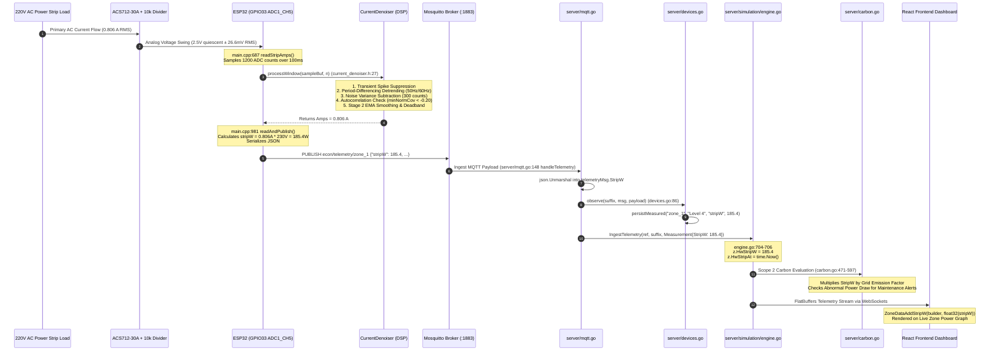

#### Detailed Step-by-Step Code References:
1. **Physical Front End**: ACS712 Hall sensor in series with the AC power strip conductor. Output ($V_{CC}/2 \pm 66\,\text{mV/A}$) enters a 10kΩ/10kΩ divider, landing on **ESP32 GPIO 33** (`STRIP_ADC_PIN`).
2. **Firmware DSP Denoising (`edge/esp32/src/main.cpp:687–726`, `current_denoiser.h:27–173`)**:
   `readStripAmps()` samples 1200 ADC counts over 100 ms via `analogRead(STRIP_ADC_PIN)`. `stripDenoiser.processWindow()` suppresses spikes (`:43–46`), eliminates intra-window DC drift via period-differencing (`:54–90`), subtracts ADC noise variance $\sigma^2 = 300$ (`:103–105`), evaluates autocorrelation covariance ($< -0.20$, `:114–150`), and applies Stage 2 EMA smoothing ($\alpha = 0.35$) with a $0.03\,\text{A}$ deadband (`:168–172`).
3. **MQTT Publish (`main.cpp:981, 1017–1020`)**:
   Computes `stripW = round(stripAmps * gCfg.plugMainsV * 10) / 10.0`, serializes via ArduinoJson into `doc["stripW"]`, and publishes to `econ/telemetry/<ZONE_TOPIC>`.
4. **Broker Ingestion & Routing**: Mosquitto authenticates client `econ-esp32-zone_1`, checks ACLs, and routes to `econ/telemetry/+`.
5. **Go Backend Ingestion (`server/mqtt.go:148–209`)**:
   `handleTelemetry()` unmarshals JSON into `telemetryMsg`. If `RawFallback == true`, routes `rawStripSamples` to `simulation.NewCurrentDenoiser()` to compute True-RMS server-side (`:166–176`).
6. **Device Registry & State Ingestion (`server/devices.go:154, 164`, `server/simulation/engine.go:704–707`)**:
   `registry.observe()` records arrival statistics and enqueues to TimescaleDB. `engine.IngestTelemetry()` binds `z.HwStripW = 185.4` and sets `z.HwStripAt = time.Now()`.
7. **Downstream Carbon & UI Streaming**:
   `server/carbon.go:471–475` computes Scope 2 Operational Carbon ($kg\,\text{CO}_2\text{e} = \frac{\text{Watts} \times \text{hours}}{1000} \times \text{GridFactor}$). `server/simulation/engine.go:2758–2763` packs `stripW` into the FlatBuffers binary vector and streams it to the dashboard at 1 Hz.

---

### 10.2 Trace #2: Simulation Step to Persistence & WebSocket Streaming

This trace tracks an internal physics step as telemetry updates room states, triggers database writes, and streams binary frames to clients.

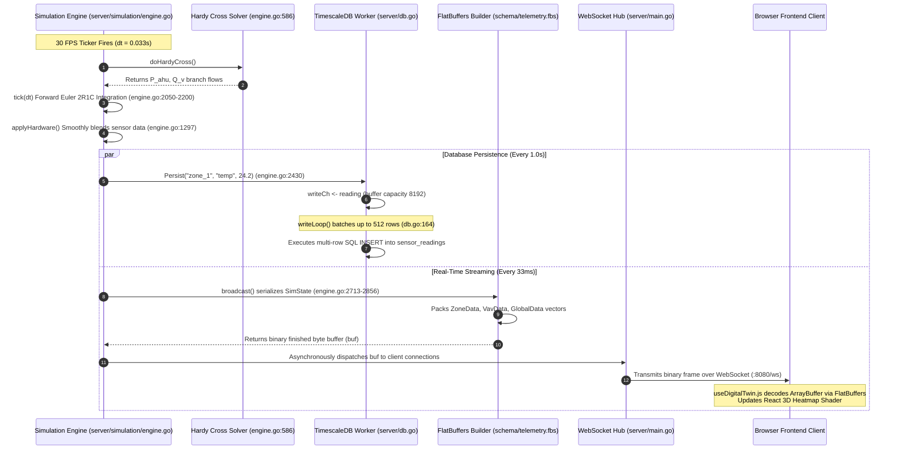

#### Detailed Step-by-Step Code References:
1. **Physics Execution (`server/simulation/engine.go:2050–2200`)**:
   `Engine.tick(dt)` evaluates Forward Euler equations for $T_{\text{air}}$ and $T_{\text{wall}}$. `doHardyCross()` (`:586–599`) recalculates duct system resistance $R_{\text{system}}$ and static pressure $P_{\text{ahu}}$.
2. **Sensor Blending & Shadow Twin (`engine.go:1297–1316`)**:
   `applyHardware()` nudges simulation temperature toward physical measurement `z.Temp += (z.HwTemp - z.Temp) * 0.1`. The sensor-free Shadow Twin integrates in parallel (`z.ShadowTemp`), updating residual EMA `z.ResidualEma += (|z.HwTemp - z.ShadowTemp| - z.ResidualEma) * 0.02`.
3. **Asynchronous Database Queue (`server/db.go:45–77, 164–216`)**:
   `engine.broadcast()` enqueues metrics into `writeCh chan reading` (capacity 8192). Background worker `writeLoop()` batches up to 512 rows or flushes every 500 ms, executing parameterized multi-row SQL inserts into hypertable `sensor_readings`.
4. **FlatBuffers Binary Encoding (`server/simulation/engine.go:2713–2856`)**:
   Encodes `ZoneData`, `VavData`, and `GlobalData` into a `SimState` FlatBuffers buffer using `server/schema/telemetry.fbs`.
5. **WebSocket Broadcast (`server/main.go:211–335`)**:
   Iterates active WebSocket client connections, writing `websocket.BinaryMessage` buffers without blocking the engine physics lock.

---

### 10.3 Trace #3: AI/ML Foundation Model Forecast to 3D Digital Twin WebGL Heatmap Shader

This trace follows a machine learning forecast query from the Go engine through the Python foundation model, into the FlatBuffers binary stream, and onto the WebGL 3D canvas.

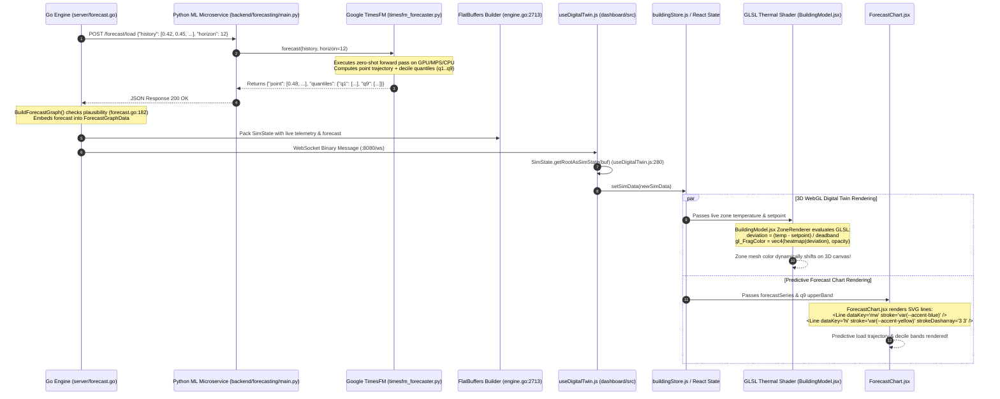

#### Detailed Step-by-Step Code References:
1. **Forecast Query Dispatch (`server/forecast.go:44–126, 594–681`)**:
   `BuildForecastGraph()` extracts the rolling 12-sample load history from `engine.loadHistory`. Concurrently dispatches an HTTP POST request to the Python microservice at `http://localhost:8000/forecast/load`.
2. **Zero-Shot Foundation Model Inference (`backend/forecasting/timesfm_forecaster.py:182–243`)**:
   FastAPI route `/forecast/load` (`main.py:122–145`) calls `TimesFmForecaster.forecast()`. The model evaluates the univariate sequence on Apple Silicon MPS or CUDA GPU, returning a 12-step point trajectory along with quantile deciles `q1` through `q9`.
3. **Plausibility Auditing & Graph Assembly (`server/forecast.go:182–226`)**:
   `checkPlausible()` audits the forecast peak against the building's historical load bounds. The result is packed into `ForecastGraphData` with point series and upper quantile deciles.
4. **WebSocket Binary Serialization (`server/simulation/engine.go:2713–2856`)**:
   The engine encodes zone temperatures and global metrics into binary FlatBuffers `SimState` bytes and transmits them across WebSocket connections.
5. **Frontend Reception & Unpacking (`dashboard/src/useDigitalTwin.js:241–397`)**:
   `ws.onmessage` ingests incoming `ArrayBuffer` data, calls `SimState.getRootAsSimState(buf)`, and maps zone temperatures into React state (`setSimData`).
6. **WebGL 3D Canvas Shader Update (`dashboard/src/BuildingModel.jsx:319–434`)**:
   `ZoneRenderer` extracts `simState.zones[zoneId].temp`. In `useFrame`, `material.uniforms.temperature.value` lerps toward the live temperature. The custom GLSL fragment shader evaluates `deviation = (temperature - setpoint) / deadband`, shifting the zone mesh color from green (optimal) to yellow/red (overheating) or blue (overcooling).
7. **Forecast Chart Rendering (`dashboard/src/ForecastChart.jsx:150–260`)**:
   Recharts `<ResponsiveContainer>` renders `<Line dataKey="mw">` for the point forecast and `<Line dataKey="hi" strokeDasharray="3 3">` for the 90th percentile risk band.

---

## 11. Summary Source File & Line Range Index

| Component / Subsystem | Repository Source File Path | Exact Line Range | Core Function / Identifier | Architectural Layer |
|:---|:---|:---:|:---|:---:|
| **ESP32 Firmware Core & Sensor Sampling** | `edge/esp32/src/main.cpp` | Lines 1–1100 | `setup()`, `loop()`, `readSht30()`, `readStripAmps()` | Layer 1 (Edge) |
| **ESP32 Current DSP Denoising** | `edge/esp32/src/current_denoiser.h` | Lines 27–173 | `CurrentDenoiser::processWindow()` | Layer 1 (Edge) |
| **Pico MicroPython Firmware** | `edge/pico/main.py` | Lines 1–364 | `run_serial()`, `run_wifi()`, `wdt.feed()` | Layer 1 (Edge) |
| **Pico Dual PIR C++ Firmware** | `edge/pico/src/main.cpp` | Lines 1–96 | `setup()`, `loop()`, `sendTelemetry()` | Layer 1 (Edge) |
| **Gateway Failsafe Daemon** | `edge/raspberry_pi/gateway.py` | Lines 1–155 | `failsafe_loop()`, `on_message()` | Layer 2 (Broker) |
| **Mosquitto ACL Configuration** | `server/mosquitto/acl` | Lines 1–15 | `user econ-engine`, `user econ-node` | Layer 2 (Broker) |
| **MQTT Backend Subscriber & Fallback DSP** | `server/mqtt.go` | Lines 58–122, 148–209 | `startMQTT()`, `handleTelemetry()` | Layer 2 (Broker) |
| **2R1C Thermodynamic Integration** | `server/simulation/engine.go` | Lines 2050–2200 | `func (e *Engine) tick(dt float64)` | Layer 3 (Engine) |
| **Hardy Cross Fluid Airflow Solver** | `server/simulation/engine.go` | Lines 570–599 | `sizeFanToBuilding()`, `doHardyCross()` | Layer 3 (Engine) |
| **RLS Online Room Dynamics** | `server/simulation/dynamics.go` | Lines 226–376, 505–587 | `observeRoom()`, `update()`, `SetbackCeiling()` | Layer 3 (Engine) |
| **Online Learned Baselines** | `server/simulation/baselines.go` | Lines 128–157, 227–254 | `observe()`, `score()` | Layer 3 (Engine) |
| **Autonomous Plug-Load Controller (APLC)**| `server/simulation/plugs.go` | Lines 135–181, 209–243 | `plugTick()`, `PlugSnapshot()` | Layer 3 (Engine) |
| **Pre-Cooling Decision Poller** | `server/precool.go` | Lines 52–192 | `func precoolLoop(...)` | Layer 3 (Engine) |
| **Vacancy Setback Optimizer** | `server/simulation/engine.go` | Lines 862–974 | `func (e *Engine) actuate()` | Layer 3 (Engine) |
| **Shadow Twin & AFDD Diagnostics** | `server/simulation/engine.go` | Lines 1297–1316, 2186–2198 | `applyHardware()`, `ResidualEma` | Layer 3 (Engine) |
| **Scope 2 Carbon & Maintenance Alerts** | `server/carbon.go` | Lines 118–150, 420–530 | `CalculateScope2Emissions()`, alerts | Layer 3 (Engine) |
| **PeakLoadLSTM Neural Network** | `backend/forecasting/model.py` | Lines 5–22 | `class PeakLoadLSTM(nn.Module)` | Layer 4 (AI/ML) |
| **Google TimesFM Foundation Forecaster** | `backend/forecasting/timesfm_forecaster.py` | Lines 47–74, 182–243 | `TimesFmForecaster.forecast()` | Layer 4 (AI/ML) |
| **FastAPI Forecasting Server** | `backend/forecasting/main.py` | Lines 30–43, 122–145, 174–221| `/health`, `/forecast/load`, `/predict` | Layer 4 (AI/ML) |
| **Go Forecast Orchestrator & IPC** | `server/forecast.go` | Lines 44–126, 182–226, 594–681| `BuildForecastGraph()`, `checkPlausible()` | Layer 4 (AI/ML) |
| **Offline Model Catalog & Exporter** | `server/modelcatalog.go`, `modelexport.go` | Lines 34–85, Lines 23–60 | `GetRecommendations()`, `ExportBundle()` | Layer 4 (AI/ML) |
| **TimescaleDB Schema & Policies** | `server/db/init.sql` | Lines 1–53 | `CREATE TABLE sensor_readings`, hypertables | Layer 5 (Database) |
| **Database Async Write Buffer & Batcher** | `server/db.go` | Lines 45–77, 164–216 | `initDB()`, `writeLoop()` | Layer 5 (Database) |
| **Historical & Series Query Handlers** | `server/db.go` | Lines 218–399 | `historyHandler()`, `seriesHandler()` | Layer 5 (Database) |
| **REST API Server & Route Dispatcher** | `server/main.go` | Lines 25–185 | `main()`, route registration (32 endpoints) | Layer 6 (API) |
| **WebSocket Connection & Broadcast** | `server/main.go` | Lines 211–335 | `handleWebSocket()` | Layer 6 (API) |
| **CSWSH & Token Security Gates** | `server/auth.go` | Lines 37–155 | `checkOrigin()`, `tokenMatches()` | Layer 6 (API) |
| **FlatBuffers Binary Schema** | `server/schema/telemetry.fbs` | Lines 1–77 | `table ZoneData`, `table SimState` | Layer 6 (API) |
| **Frontend Bootloader & State Store** | `dashboard/src/main.jsx`, `buildingStore.js` | Lines 12–19, Lines 19–84 | Two-stage bootloader, model switcher | Layer 7 (Frontend) |
| **Digital Twin WebSocket Hook** | `dashboard/src/useDigitalTwin.js` | Lines 261–403 | FlatBuffers ArrayBuffer decoding @ 30 FPS | Layer 7 (Frontend) |
| **3D BIM Model & GLSL Heatmap Shader** | `dashboard/src/BuildingModel.jsx` | Lines 12–60, 319–434 | CSG subtraction, custom GLSL shader | Layer 7 (Frontend) |
| **Predictive Forecast Chart Component** | `dashboard/src/ForecastChart.jsx` | Lines 94–145, 150–260 | Honest zero-curve fallback, Recharts deciles| Layer 7 (Frontend) |
| **Operational Telemetry & Carbon Panels**| `dashboard/src/GlobalMetricsPanel.jsx` | Lines 1–624 | Power gauges, COP, Scope 2 emissions | Layer 7 (Frontend) |
| **APLC Plug-Load Panel** | `dashboard/src/PlugLoadPanel.jsx` | Lines 1–320 | Non-HVAC sockets, phantom shedding | Layer 7 (Frontend) |
| **AI Insights & Evidence Visualization** | `dashboard/src/AiInsightsPanel.jsx`, `RecommendationEvidence.jsx` | Lines 58–109, Lines 16–100 | Visual $\sigma$-strip, RLS response curves | Layer 7 (Frontend) |
